# Lab 8: Microsoft 365 Copilot for Business Users - Hack in a Day

## Estimated Duration: 20-45 minutes per challenge (~4 hours 45 minutes total)

> English version of the lab guide. The Korean translation is available in [README.md](README.md).
> Source: CloudLabs Lab Guide - "Microsoft 365 Copilot for Business Users - Hack in a Day" (Spektra Systems). Durations are summed from the per-challenge times (20-45 minutes each, ~4 hours 45 minutes total); the source overview states "four hours".

Welcome to the Microsoft 365 Copilot Business User Productivity Hack in a Day! In this lab, you will work hands-on with Microsoft 365 Copilot across Outlook, Teams, Word, Excel, and Microsoft 365 Chat to build practical skills you can apply in your daily work from day one.

## Scenario

Business professionals spend hours every week on tasks that should take minutes: reading through long email threads, drafting communications from scratch, searching for information buried across SharePoint and Teams, reformatting documents, and manually querying spreadsheets that need a pivot table to answer a simple question. Microsoft 365 Copilot is embedded directly in the tools people already use. It reads the Microsoft Graph - the participant's own emails, calendar, documents, and Teams messages - and uses that context to draft, summarise, analyse, and create on demand.

This HIAD gives business professionals a focused, hands-on experience across every major Copilot surface in four hours. Each challenge presents a realistic workplace scenario drawn from sales, HR, finance, and operations contexts. Every task produces a real output - a drafted email, a polished document, a data insight, a cross-app briefing - that the participant can evaluate and adapt for their own daily work. By the end of the session, each participant leaves with a personal prompt library of tested, reusable patterns ready to use in their own inbox, documents, and meetings from day one.

## Introduction

Microsoft 365 Copilot is embedded in the apps participants already use. No additional software or configuration is required. Participants access Copilot through the Copilot button in each application and through microsoft365.com/chat (Microsoft 365 Chat, also known as BizChat).

Every Copilot response is grounded in the participant's own Microsoft Graph data: their emails, documents, calendar, and Teams messages. Participants can use **/** to reference specific files directly in prompts, and Copilot cites sources so every output is verifiable.

## Key Tools and Services

In this lab, you will work with:

- **Microsoft 365 Copilot** - AI assistant embedded across all Microsoft 365 applications
- **Outlook** - Summarise threads, draft emails, Coaching by Copilot, multi-audience writing
- **Teams** - Draft channel posts, rewrite messages, summarise threads and chats
- **Word** - Generate documents, rewrite sections, query large documents, create summaries
- **Excel** - Analyse datasets, create charts, add calculated columns, generate recommendations
- **Microsoft 365 Chat (BizChat)** - Cross-app search, multi-source prompts, structured briefings
- **Microsoft Graph Grounding** - Connects Copilot to your emails, calendar, files, and Teams messages

## Learning Objectives

By the end of this Hack in a Day, you will learn how to:

- Navigate the Copilot entry point across all major Microsoft 365 applications
- Apply the four-element prompt framework (Goal, Context, Source, Format) to write effective prompts
- Use iterative refinement to improve Copilot outputs through follow-up instructions
- Summarise long email threads and draft professional communications in Outlook
- Draft and rewrite channel posts and extract intelligence from Teams conversations
- Generate and rewrite Word documents, and query large documents as a knowledge base
- Analyse datasets, answer business questions, and create charts in Excel without writing formulas
- Combine data from multiple sources in Microsoft 365 Chat to produce cross-app briefings
- Build a personal prompt library of reusable patterns for your own daily work

## Hack in a Day Format: Challenge-Based

This hack in a day follows a challenge-based format with six challenges plus a capstone that move through every major Copilot surface:

- **Challenge 1: Orientation and Prompt Engineering Fundamentals** - Navigate Copilot across all apps, learn the four-element framework, practise iterative refinement
- **Challenge 2: Copilot in Outlook - Email Mastery** - Summarise threads, draft persuasive emails, write for multiple audiences
- **Challenge 3: Copilot in Teams - Channel and Chat Intelligence** - Draft channel updates, rewrite messages, search across apps, summarise threads
- **Challenge 4: Copilot in Word and PowerPoint - Document Authoring and Analysis** - Generate business cases, rewrite specific sections, query large documents, create board-level summaries, and turn a project report into an executive slide deck in PowerPoint
- **Challenge 5: Copilot in Excel - Data Insights Without Formulas** - Analyse sales data, answer business questions, create charts, add calculated columns
- **Challenge 6: Microsoft 365 Chat (BizChat) - Cross-App Intelligence** - Combine multiple data sources, build structured briefings, build your personal prompt library
- **Challenge 7: The Phoenix Briefing - Your Prompts, Your Outputs** - Capstone scenario: three real deliverables, no prompts provided, time pressure, all surfaces in play

Throughout each challenge, you will:

- Apply and reinforce the four-element prompt framework in a new application context
- Practise iterative refinement to get production-quality outputs
- Evaluate every Copilot output against defined success criteria
- Build toward a personal prompt library you take away at the end

## Challenge Overview

You start by navigating microsoft365.com to find the Copilot entry point in each application. You learn the Goal-Context-Source-Format framework, rewrite three weak prompts into effective ones, and practise iterative refinement in Microsoft 365 Chat before touching any specific app.

In Outlook, you use the Copilot reading pane to summarise a 17-message email thread, draft a persuasive budget request, and produce the same news in two formats for different audiences.

In Teams, you write a structured project status update and refine it with Copilot Rewrite, use Copilot Rewrite to transform a rough message into a professional post, search across channels and emails in Microsoft 365 Chat, and summarise a 25-post channel thread to extract blockers and owners.

In Word, you generate a one-page business case from a prompt, rewrite sections to improve quality, query a 48-page HR handbook using only Copilot without scrolling, and use **/** to reference a project report and generate a board-level executive summary.

In Excel, you open a 500-row Q1 sales workbook, ask Copilot to identify patterns and anomalies, answer three business questions in plain English without formulas, create and iterate a chart through conversation, add a calculated column, and generate a per-region summary with an investment recommendation.

You close in Microsoft 365 Chat by combining documents, emails, and Teams messages in single prompts to produce cross-app briefings, and you design, test, and refine the single most valuable Copilot prompt for your own daily work. That prompt - along with everything you have tested across all six challenges - becomes your personal Copilot toolkit.

Challenge 7 is the capstone. No prompts are provided. You receive a realistic business scenario, three simultaneous deadlines, and success criteria with specific verifiable facts. Every deliverable is produced using prompts you write yourself, drawing on the data seeded into your environment throughout the day. This is where the skills become instinct.

## Getting Started: Prepare Your Lab Environment

Welcome to Hack in a Day: Microsoft 365 Copilot for Business Users! Your lab environment is fully configured with Microsoft 365 Copilot enabled on your account and sample data pre-loaded in Outlook and Teams. You will upload additional files to OneDrive during this Getting Started section. Let's begin by signing in and verifying your access.

### Accessing Your Challenge Environment

Once you're ready, your virtual machine and challenge guide will be available within your web browser.

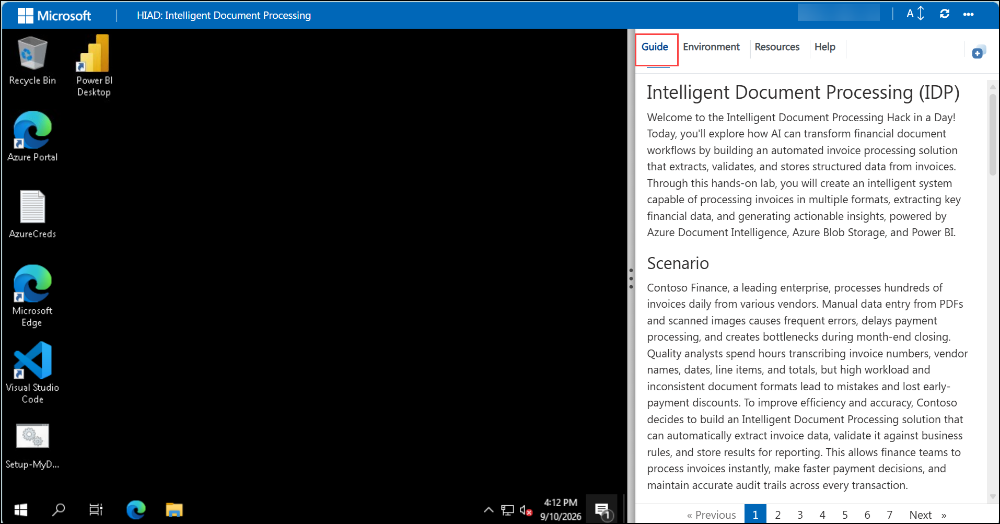

### Exploring Your Challenge Resources

To get a better understanding of your challenge resources and credentials, navigate to the Environment tab.

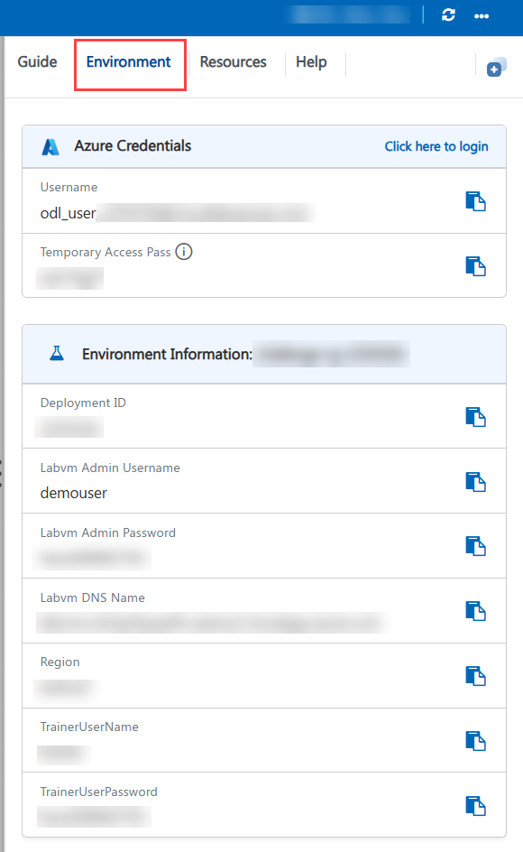

### Utilizing the Split Window Feature

For convenience, you can open the challenge guide in a separate window by selecting the Split Window button from the top right corner.

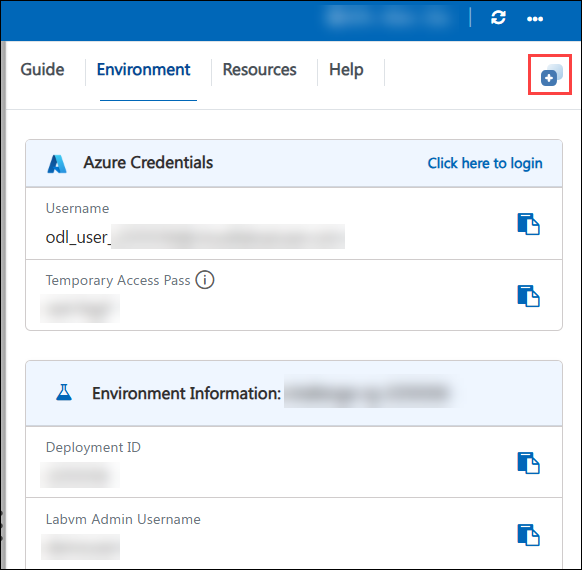

### Managing Your Virtual Machine

Feel free to start, stop, or restart your virtual machine as needed from the Resources tab. Your experience is in your hands!


> **Note:** If the VM is not in use, please **deallocate** it to avoid unnecessary resource consumption.

### Sign In to Microsoft 365

1. In the JumpVM, click on the **Microsoft Edge** browser shortcut on the desktop.

   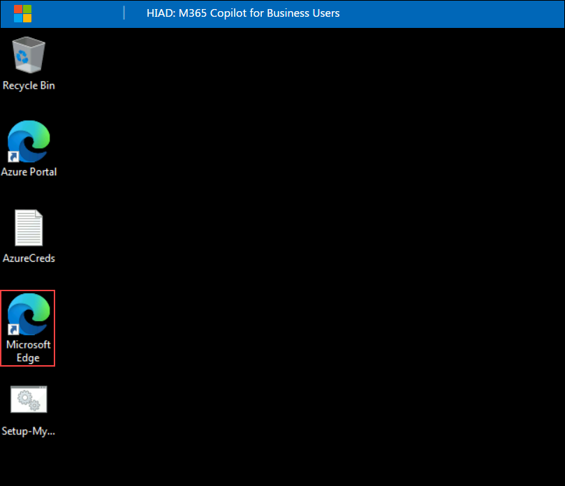

1. Open a new browser tab and navigate to the Microsoft 365 portal by entering the following URL:

   ```
   https://microsoft365.com
   ```

1. On the **Sign in** page, enter the following email address and then click **Next**.

   - Email: **<inject key="AzureAdUserEmail"></inject>**

     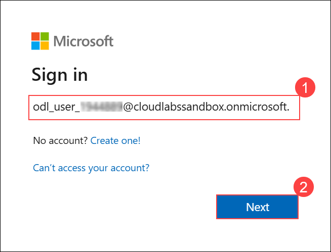

1. On the **Enter password** screen, enter the following password and then click **Sign in**.

   - Password: **<inject key="AzureAdUserPassword"></inject>**

     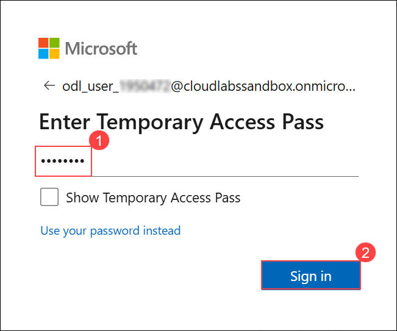

1. If you see the pop-up **Stay Signed in?**, click **No**.

   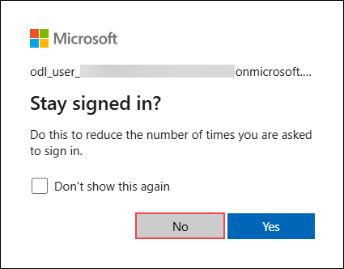

1. The Microsoft 365 Chat pane (BizChat) should open. If it opens, Copilot is enabled on your account.

   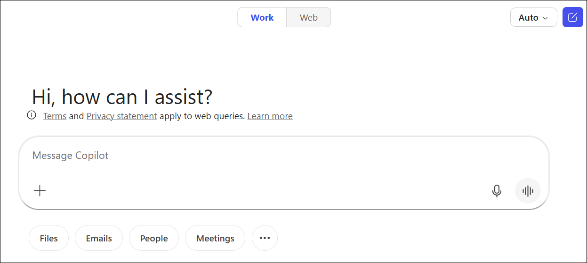

1. You should now be on the Microsoft 365 home page at **microsoft365.com**. You will see the app launcher in the top-left corner and the Copilot icon in the left navigation bar.

   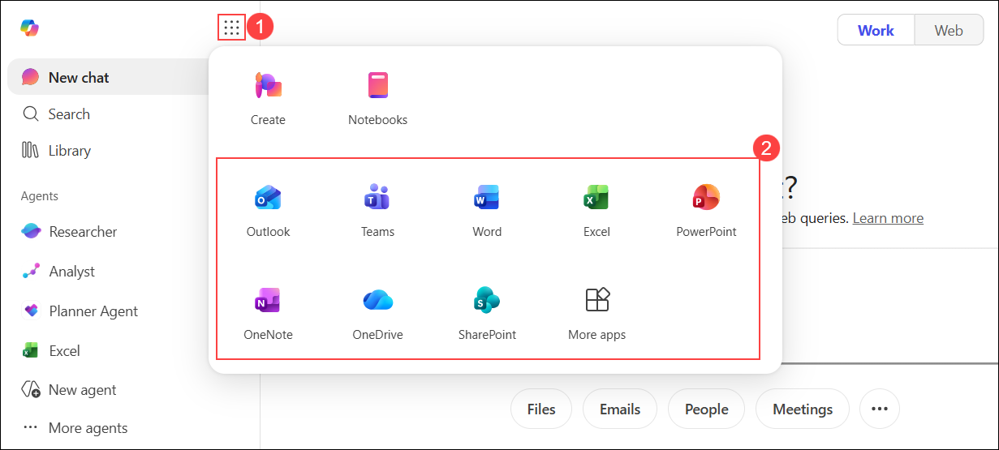

   > **Note:** The email threads and Teams channel posts required for this lab are pre-loaded in your lab environment. The Word documents and Excel workbook will be uploaded to OneDrive in the next section.

### Upload the Lab Files

You will download the lab dataset and upload the required files to your OneDrive. These files will be used in the subsequent challenges.

1. Download the lab dataset from the following link, extract the contents of the **hack-in-a-day-data-m365cp.zip** file to a local folder, and keep the extracted files ready to upload to OneDrive in the next steps. (The same dataset is also available in this repository at **[labfiles/hack-in-a-day-data-m365cp.zip](labfiles/hack-in-a-day-data-m365cp.zip)**.)

   ```
   https://sandboxdatafiles.blob.core.windows.net/datafiles/hack-in-a-day-data-m365cp.zip
   ```

1. Select the **App launcher (1)** from the top-left corner, and then select **OneDrive (2)**.

   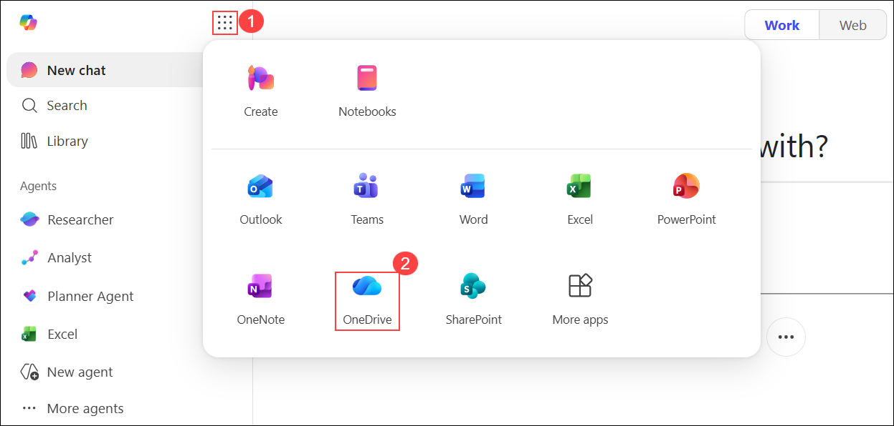

1. Select **Create or upload (1)**, and then select **Files upload (2)**.

   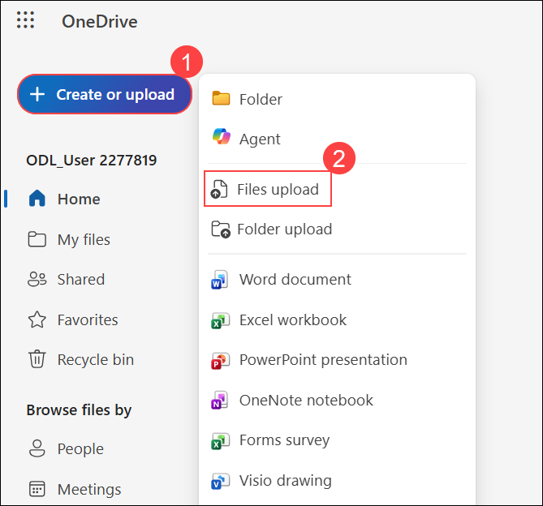

1. In the **File upload** dialog, browse to the extracted **hack-in-a-day-data-m365cp** folder, select all the extracted files, and then select **Open** to upload them to OneDrive.

   > **Note:** If a **Sign in** pop-up appears during the upload process, select **Sign in** to continue.

1. Verify that the uploaded files appear under **My files (1)** in OneDrive, as shown in **(2)**.

   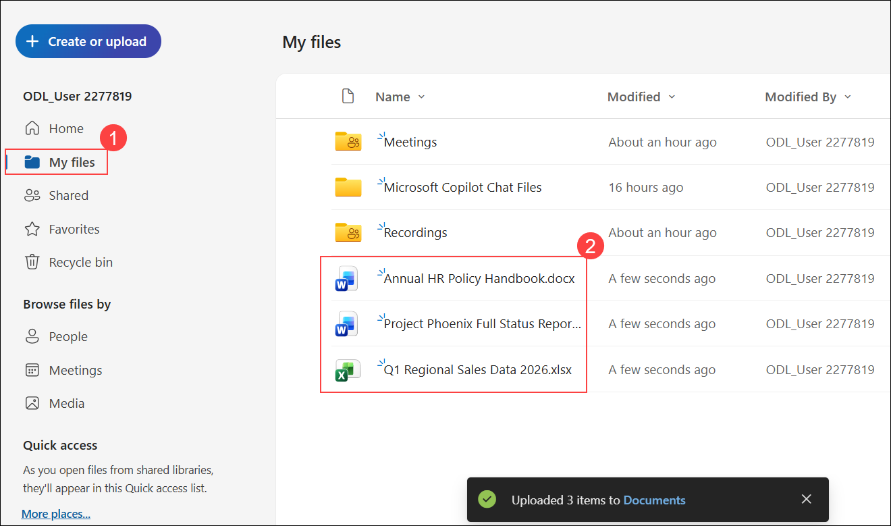

   | File | Used In |
   |------|--------|
   | Annual HR Policy Handbook.docx (48 pages) | Challenge 4 |
   | Project Phoenix Full Status Report.docx | Challenge 4 |
   | Q1 Regional Sales Data 2026.xlsx (500 rows) | Challenge 5 and 6 |

## Challenge 1: Orientation and Prompt Engineering Fundamentals

### Introduction

Before you open any specific application, you need to understand how Microsoft 365 Copilot works and where to find it. Copilot is not a separate product - it is embedded directly inside Outlook, Teams, Word, PowerPoint, Excel, and Microsoft 365 Chat. It reads your Microsoft Graph data (your emails, calendar, documents, and Teams messages) and uses that context to generate outputs on demand.

The quality of every Copilot output depends on the quality of your prompt. A vague prompt produces a generic result. A structured prompt that tells Copilot exactly what you want, why, where to look, and how to format the answer produces output you can act on immediately. This challenge gives you the framework and the practice before you move into any specific application.

### Challenge Objectives

- Sign in to microsoft365.com and locate the Copilot entry point in Outlook, Teams, Word, PowerPoint, Excel, and Microsoft 365 Chat
- Learn and apply the four-element prompt framework: Goal, Context, Source, and Format
- Rewrite three weak prompts into effective prompts using all four elements and test one in Microsoft 365 Chat
- Practise iterative refinement by applying three sequential follow-up instructions to a single draft

### Duration

20 minutes

### Your Assignment

> You have just joined the Project Phoenix programme as a business analyst. Your manager has handed you access to the team's Microsoft 365 environment and given you one instruction before anything else: "Learn how to use Copilot properly. A weak prompt wastes more time than it saves. I want to see you using the four-element framework before you touch any of the project data." This challenge is the foundation. Everything in the next six challenges depends on it.

### Steps to Complete

#### Step 1: Find Where Copilot Lives Across Microsoft 365

The only goal of this step is orientation. You are not creating or generating anything yet - you are simply opening each application and confirming where the Copilot entry point appears, so that in the later challenges you already know where to look. Treat this as a quick guided tour.

1. Ensure you are signed in to **microsoft365.com** with your lab credentials. If you have not yet signed in, follow the steps in the Getting Started guide.

1. From the Microsoft 365 home page, click the **App launcher** (waffle icon) in the top-left corner to see all available apps.

1. Please verify that Copilot is available in Outlook, Teams, Word, PowerPoint, and Excel.

1. Navigate to Microsoft 365 Chat (BizChat) by opening the following URL in a new tab:

   ```
   https://microsoft365.com/chat
   ```

   Alternatively, click the **Copilot** icon in the left navigation bar on the Microsoft 365 home page. This is the cross-app interface where Copilot can search across all your Microsoft 365 data simultaneously.

1. Confirm that you have located the Copilot entry point in all the surfaces above. Note that Microsoft 365 Chat does not require you to be inside a specific app - it is always available at the URL above or from the navigation bar.

   > **Important:** Copilot never uses your content to train the underlying foundation model. Everything stays within your organisation's Microsoft 365 tenant.

#### Step 2: Master the Four-Element Prompt Framework

The four elements of an effective prompt are:

| Element | What it means | Example |
|---------|--------------|---------|
| **Goal** | What you want Copilot to do | "Draft an email" / "Summarise this document" |
| **Context** | Background that helps Copilot understand the situation | "I need to request approval for a team event budget" |
| **Source** | Where Copilot should look for information | A specific file, email thread, or dataset referenced with "/" |
| **Format** | How the output should be structured | "Under 200 words, bullet points, professional tone" |

1. Open a text editor or a blank Word document. Read the following three weak prompts. Each one is the kind of vague instruction that produces a generic, unusable output:

   - Weak Prompt A: *"Write an email about the Q3 campaign budget."*
   - Weak Prompt B: *"Summarise the Project Phoenix status report."*
   - Weak Prompt C: *"Tell me what's happening with the vendor delay."*

   These are the kinds of prompts you might be tempted to write when you first open Copilot. None of them will produce a useful output because they are missing three of the four elements.

1. For each weak prompt, identify which elements are missing and rewrite it using all four. Aim to make each rewritten prompt immediately usable - someone reading it should know exactly what output to expect. Use the table below as a guide:

   | Weak Prompt | Goal | Context | Source | Format |
   |-------------|------|---------|--------|--------|
   | Write an email about the Q3 campaign budget | Draft a budget approval request email | Requesting £120,000 for the Q3 marketing campaign - need sign-off from finance before 30 June | Q3 Marketing Campaign Planning emails | Under 200 words, professional and persuasive, clear call-to-action as the final line |

1. Write your three rewritten prompts. There is no single correct answer - the goal is that each prompt specifies all four elements clearly.

1. Navigate to **Microsoft 365 Chat** at `https://microsoft365.com/chat`.

1. Take your best rewritten prompt from the three above and test it in Microsoft 365 Chat. Type it into the message box and press Enter.

1. Review the output. Ask yourself: Is this output immediately usable, or does it need significant editing? A well-structured four-element prompt should produce an output that needs only minor personalisation.

   > **Tip:** If the output is too generic, your Context or Source element may need more specificity. If the output is too long or too short, your Format element needs adjustment.

#### Step 3: Practise Iterative Refinement

Iterative refinement is the practice of improving a Copilot output through sequential follow-up instructions rather than trying to write the perfect prompt in a single attempt. Most production-quality outputs require two to four iterations.

1. Open **Microsoft 365 Chat** at `https://microsoft365.com/chat`.

1. Enter the following prompt exactly as written:

   ```
   Draft a one-paragraph project update for my manager about the Q3 marketing campaign. We are on track overall, but the creative agency missed the first draft deadline by three days. Professional tone, under 80 words.
   ```

1. Review the first output. Note the word count, tone, and structure. This is your baseline.

1. Now apply the first refinement. Type the following follow-up instruction:

   ```
   Make it more direct and action-oriented. Lead with the delay, not with the overall status.
   ```

   Review the updated output. Note how the structure has changed.

1. Apply the second refinement:

   ```
   Add a bullet list of next steps after the paragraph. Include three specific next steps.
   ```

   Review the updated output. Note how Copilot preserves the paragraph and adds the requested structure below it.

1. Apply the third refinement:

   ```
   Mention that the new deadline is 10 June and ask for the manager's sign-off by this Friday.
   ```

   Review the final output.

1. Compare the final version to the first draft. The final version should be significantly more specific, more actionable, and more complete - without you having to rewrite it from scratch.

   > **Key insight:** Iterative refinement works because Copilot maintains context across follow-up instructions in a conversation. You do not need to repeat your original prompt - just add what you want to change or add.

### Success Criteria

- You have located the Copilot entry point in Outlook, Teams, Word, PowerPoint, Excel, and Microsoft 365 Chat
- You have written three rewritten prompts that each include Goal, Context, Source, and Format
- You have tested at least one rewritten prompt in Microsoft 365 Chat
- You have applied three follow-up instructions to a single draft and compared the first and final outputs
- You can explain the four elements of the prompt framework in your own words

### Additional Resources

- [Microsoft 365 Copilot adoption resources](https://adoption.microsoft.com/copilot/)
- [Write effective prompts for Microsoft 365 Copilot](https://support.microsoft.com/topic/write-effective-prompts-for-microsoft-365-copilot-5b8c2e25-8e19-4c3c-91d8-5f71f98b8cd7)
- [Microsoft 365 Copilot prompt gallery](https://adoption.microsoft.com/copilot/prompt-gallery/)

## Challenge 2: Copilot in Outlook - Email Mastery

### Introduction

Email is where most business professionals spend the most time - and where poorly written or unread messages cause the most friction. Copilot in Outlook addresses this at both ends: it summarises what you have already received and drafts what you need to send. The challenge in this session is not just to use Copilot but to evaluate the outputs critically and use follow-up instructions to get results that are genuinely usable in your real inbox.

You will work through three tasks that represent the most common and highest-value email scenarios in any business role: summarising a complex thread, drafting a persuasive request, and producing the same message for two very different audiences.

### Challenge Objectives

- Summarise a 17-message email thread using the Copilot reading pane and answer three specific questions from the summary alone
- Draft a persuasive budget request email that meets five defined quality criteria
- Create two versions of the same news for different audiences: executive (under 80 words) and operational team (under 200 words with bullet-pointed next steps)

### Duration

45 minutes

### Prerequisites

- Completed Challenge 1
- Signed in to Outlook at microsoft365.com

### Your Assignment

> You are covering for the project coordinator today. Three things just landed in your inbox: a 17-message campaign planning thread that reached decisions you were not part of, an urgent client email asking for a project status update by the end of Thursday, and a product launch announcement that needs to go out to two very different audiences. You have 30 minutes before a back-to-back run of meetings. Use Copilot in Outlook to get on top of all three situations and produce polished, ready-to-send communications - without reading a single message in full.

### Steps to Complete

#### Step 1: Summarise a Complex Email Thread

The pre-loaded email thread "Q3 Marketing Campaign Planning" contains 17 messages from six senders across four days. Reading this manually would take 10 to 15 minutes. Copilot can summarise it in seconds.

1. Open **Outlook** from the Microsoft 365 home page or navigate to:

   ```
   https://outlook.office.com
   ```

1. In your inbox, search for **Q3 Marketing Campaign Planning**. You will see several messages with this subject from different senders (Tom Hughes, Lisa Park, James Wright, Sarah Chen, and others). Open any one of them - they are all part of the same conversation.

1. With the message open in the reading pane, click the **Copilot** icon to open the Copilot panel.

1. In the Copilot panel, type a prompt asking it to summarise the conversation, for example:

   ```
   Summarise this email thread. List the key decisions made, the action items and who owns them, and any unresolved disagreements.
   ```

1. Read the summary Copilot generates. It should cover the key decisions, action items, and the current status of the discussion.

   > **Note:** The one-click **Summary** button that appears at the top of an open email does not always work straight away - on a freshly loaded mailbox, it can take a little time before it becomes available.

#### Step 2: Draft a Persuasive Budget Request Email

1. In Outlook, click **New mail** to open a blank compose window.

1. Click the **Copilot** icon in the compose toolbar (it appears above the message body). Select **Draft with Copilot**.

1. **This time you write the prompt yourself - no prompt is provided.** This is the point of the exercise: you take the raw facts below and turn them into a single four-element prompt (Goal, Context, Source, Format) that you type into the Draft with Copilot box. The facts you have to work with:

   - You are requesting finance approval for a **£5,000 sponsorship budget**
   - The event is on **15 July** - approximately **120 attendees**, including key enterprise prospects
   - Finance must approve by **30 June**

   The email Copilot produces from your prompt must meet all five criteria below. Treat these as the specification you write your prompt against - build them into the prompt up front rather than checking them afterwards:

   - Under 200 words
   - Clear call-to-action as the very last line (not buried in the middle)
   - Leads with the business objective - why this matters - before mentioning the budget figure
   - States the approval deadline explicitly
   - Professional and persuasive tone

   > **Think about format:** Copilot needs Goal, Context, Source, and Format. The more precisely you specify the structure (what goes first, where the CTA lands, the word limit), the less refining you will need to do.

1. Review the draft Copilot inserts into the compose window. Evaluate it against all five criteria. If any criterion is not met, write a follow-up instruction that corrects exactly that one thing - do not regenerate from scratch.

1. Once all five criteria are met, the draft is complete. You do not need to send it.

#### Step 3: Write a Multi-Audience Email Pair

The same news often needs to reach two very different audiences. An executive sponsor wants strategic context in under a minute of reading. A project team needs specific actions and deadlines. Copilot can produce both versions quickly - but only if you specify the audience and format precisely.

**The news to communicate:** The product launch is confirmed for 1 August. The venue is booked. The marketing campaign starts on 15 July. The team must submit all final collateral by 10 July.

1. In Outlook, click **New mail** to open a blank compose window.

1. Click the **Copilot** icon and select **Draft with Copilot**.

1. **You write this prompt yourself - no prompt is provided.** Build a prompt for the **executive sponsor version**. The news to communicate: launch confirmed 1 August, venue booked, marketing campaign starts 15 July, team collateral deadline 10 July.

   Audience profile for this version:

   - A senior executive who reads fast and needs strategic confidence
   - Does not want to know about collateral deadlines or operational steps
   - Under 80 words, no bullet points, authoritative and brief

   > Write the prompt. Think about what to leave OUT as much as what to include.

1. Review the draft. Verify it is under 80 words and contains no bullet points or operational detail.

1. Open a second new mail compose window. Click **Copilot** and select **Draft with Copilot**.

1. **Again, you write this prompt yourself - no prompt is provided.** Build a prompt for the **project team version**. Same news, completely different audience:

   - Team members who need to take specific actions before the launch
   - The 10 July collateral deadline is the most important item for this audience
   - Under 200 words, bullet-pointed next steps with specific actions and dates
   - Direct and action-oriented - they need to know what to do and by when

1. Review the team version. Verify it is under 200 words and includes a bullet-pointed next steps section with the 10 July date present.

1. Compare the two drafts side by side. Confirm the following:

   - The executive version strips out operational detail and bullet points
   - The team version includes specific actions with the 10 July deadline
   - Both versions accurately convey the core news (launch confirmed, 1 August)
   - Both are within the specified word counts

   > **Evaluate:** Could you send both emails as-is with only minor personalisation (adding the recipient's name)? If not, identify one follow-up instruction that would fix the gap.

### Success Criteria

- Your budget request draft meets all five criteria: under 200 words, clear CTA, objective-first structure, deadline mentioned, persuasive tone
- You produced two distinct email versions that each passed their audience-specific criteria
- You practised at least two follow-up refinement instructions across the three tasks

### Additional Resources

- [Summarise an email thread with Copilot in Outlook](https://support.microsoft.com/office/summarize-an-email-thread-with-copilot-a79873f2-396b-46dc-b852-7fe5947ab640)
- [Draft an email message with Copilot in Outlook](https://support.microsoft.com/office/draft-an-email-message-with-copilot-in-outlook-3eb1d053-89b8-491c-8a6e-746015238d9b)
- [Email coaching by Copilot in Outlook](https://support.microsoft.com/office/email-coaching-by-copilot-in-outlook-91a3cd56-1586-4a31-85c7-2eb8cdb02405)

## Challenge 3: Copilot in Teams - Channel and Chat Intelligence

### Introduction

Teams is where most project communication happens - but it is also where information gets buried fastest. Long threads, multiple channels, and rapid-fire messages make it hard to stay current without spending hours reading. Copilot in Teams addresses this in two directions: it helps you produce better outbound communication faster (drafting and rewriting), and it helps you extract intelligence from communication you have already received (summarising and searching).

In this challenge, you will write a structured project status update and use Copilot to refine it, transform a rough unstructured message into a professional post using Copilot Rewrite, search across Teams and other Microsoft 365 data sources to answer specific project questions, and summarise a long channel thread to identify blockers and owners without reading every post.

### Challenge Objectives

- Write a structured project status update yourself, then use Copilot Rewrite to refine it (under 120 words, bullet-pointed progress)
- Type a rough vendor message and use Copilot rewrite to produce a clear, professional, action-oriented post under 60 words
- Search across Teams channels, emails, and documents in Microsoft 365 Chat to answer three specific questions about a project
- Summarise a 25-post channel thread and use the summary alone to identify blockers, owners, and resolution status

### Duration

40 minutes

### Prerequisites

- Completed Challenge 1 and Challenge 2
- Access to the pre-loaded Project Phoenix Teams channel in your lab environment

### Your Assignment

> The Project Phoenix senior stakeholder review starts in 45 minutes. You have not checked the Teams channel in three days. The meeting chair - James Whitfield (CTO) - wants three things ready before the call starts: a structured status post in the General channel, a professional escalation message about the vendor situation, and answers to three specific questions about the blockers. You cannot read 25 posts in 45 minutes. Use Copilot in Teams and Microsoft 365 Chat to get briefed and produce every deliverable before the meeting starts.

### Steps to Complete

#### Step 1: Use Copilot Rewrite in Teams

> **Note:** Copilot in the Teams compose box works differently from Outlook and Word - there is no blank-slate "Draft with Copilot" option. The Copilot button only appears after you have typed something, and it offers **Rewrite**, **Proofread**, and **Adjust**. The flow is always: type something first, then use Copilot to refine it.

You will practise this twice - first with content you write yourself, then with a deliberately rough message from the guide.

##### Part A: Your Own Status Update

1. Open **Microsoft Teams**.

1. In the left navigation pane, click **Teams** and locate the **Project Phoenix** team. Open the **General** channel.

1. Click **Post in channel** at the bottom of the channel to open the compose box.

1. Write your own rough draft of the status update directly in the compose box. It does not need to be polished - just cover the four content items below in any order:

   - Overall progress: the programme is 65% complete
   - This week's win: Phase 3 (API Integration Layer) is complete - all unit tests passing
   - Next week's focus: front-end integration and UAT preparation
   - Risk to flag: UAT environment has a configuration issue - IT expects it to be resolved by Wednesday

1. Once you have typed something, the **Copilot** icon (sparkle icon) will appear in the formatting toolbar below the compose box. Click it and select **Rewrite**.

1. Review what Copilot produces. Verify it meets all four criteria:

   - Under 120 words
   - Bullet points used for the progress section
   - All four content elements present (progress, achievement, next steps, risk)
   - Professional but friendly tone

   If any criterion is not met, click the Copilot icon again and use **Adjust** to refine the specific element that is missing.

1. Personalise the opening line if needed, then click **Post in channel** to post it.

   > **Tip:** The opening line of a channel post sets the tone for how it will be read. A personalised opener signals to the team that the update came from a person, not a template.

##### Part B: Rewrite a Rough Vendor Escalation

Poor written communication is one of the most common sources of misunderstanding in the workplace. Copilot Rewrite can take a rough, unstructured thought and turn it into a clear, professional message in seconds.

1. In the **Project Phoenix** channel compose box, type the following rough message exactly as written (do not correct it - the roughness is intentional):

   ```
   Hey so basically the vendor said they probably can't deliver by our date, and we need to figure this out quickly because it might affect the launch timeline, and also I think someone needs to call them since emails haven't been getting replies
   ```

1. Click the **Copilot** icon and select **Rewrite**.

1. Review the rewritten version Copilot produces. Verify it meets the criteria:

   - Under 60 words
   - Clearly identifies the issue (vendor delivery risk)
   - Identifies the impact (potential launch timeline delay)
   - Specifies the action needed (someone needs to call the vendor)

1. Now look at the rewritten message critically. It is professional and clear - but it still will not result in anyone taking action today. Something specific is missing. Identify what it is and use **Adjust** to add it.

   > **Think:** A professional escalation message should answer three questions for the reader: what is the problem, why does it matter right now, and who does what by when? Check which of those is missing.

1. Compare the original rough text to the final polished version. Note how the professional version achieves the same goal in fewer words with a clearer call to action.

   > **Evaluate:** Would you be comfortable sending the polished version to a senior stakeholder? If not, identify one more follow-up instruction that would make it ready.

#### Step 2: Search for Project Intelligence Across Teams

Microsoft 365 Chat (BizChat) can search across all your Microsoft 365 data - Teams channels, emails, and documents - in a single query. This is significantly faster than manually checking each source.

1. Open **Microsoft 365 Chat** by navigating to:

   ```
   https://microsoft365.com/chat
   ```

   Or click the **Copilot** icon in the left navigation bar of the Microsoft 365 home page.

1. Ask the following three questions, one at a time. After each answer, note the source that Copilot cites:

   **Question 1:**

   ```
   What has been discussed about the Project Phoenix launch date? Check Teams channels, emails, and any shared documents.
   ```

   Note the source cited for this answer.

   **Question 2:**

   ```
   Have any blockers or concerns been raised about testing or UAT for Project Phoenix? Look across Teams channels and emails.
   ```

   Note the source cited for this answer.

   **Question 3:**

   ```
   What files were shared in the Project Phoenix Teams channel this week?
   ```

   Note the source cited for this answer.

1. For each answer, evaluate the source citation: Is it a real, identifiable document or message? Is it specific enough that you could navigate to it to verify? If Copilot cannot cite a source, treat the answer as unverified.

   > **Key principle:** Copilot cites its sources so every output is verifiable. This is what makes it safe to act on Copilot outputs in a professional context - you can always trace the answer back to the original data.

#### Step 3: Summarise a Long Channel Thread

1. In Microsoft Teams, navigate to the **Project Phoenix** channel.

1. Locate the thread titled **Launch Readiness Review**. This thread contains 25 posts from multiple team members over three days. Use the channel search to find it if needed.

1. Open the thread by clicking on it. Once the thread is fully loaded, scroll to the **bottom of the thread**. You will see a **Summarize thread** button at the bottom.

1. Click **Summarize thread**. Copilot will move to the top of the thread and display the summary.

1. Read the summary Copilot generates.

1. On the right side of the thread, the **Copilot** panel will be open. Using only the summary - do not scroll through the 25 posts manually - ask Copilot the following three questions one at a time in the Copilot panel's message box. Type each question exactly:

   **Question 1:**

   ```
   What were the top three blockers discussed in this thread?
   ```

   **Question 2:**

   ```
   Who is responsible for each blocker?
   ```

   **Question 3:**

   ```
   Was a final decision reached, or is the thread still open?
   ```

   For each answer, note what Copilot tells you.

1. Validate one of the three answers by scrolling to the relevant post in the original thread.

   > **Evaluate:** How much time did summarising this thread save compared to reading all 25 posts? Could you confidently represent this thread's status in a stakeholder meeting based solely on the Copilot summary?

### Success Criteria

- You drafted a project status update that meets all four criteria: under 120 words, bullet-pointed progress, all four content elements, professional tone
- You transformed the rough vendor message into a professional post under 60 words with a deadline added through a follow-up instruction
- You answered all three project intelligence questions in Microsoft 365 Chat and noted a source citation for each
- You identified blockers, owners, and resolution status from the 25-post thread using only the Copilot summary and follow-up questions

### Additional Resources

- [Use Copilot to compose a message in Microsoft Teams](https://support.microsoft.com/office/use-copilot-to-compose-a-message-in-microsoft-teams-efbf0768-d9e9-4ddb-8dea-a7b11b680b7d)
- [Use Microsoft 365 Chat to find things across your work life](https://support.microsoft.com/topic/use-microsoft-365-chat-to-find-things-across-your-work-life-4c5df3b2-5e9c-4949-ba00-5b0a2f84c42d)
- [Summarise channel conversations with Copilot in Teams](https://support.microsoft.com/office/summarize-channel-conversations-with-copilot-in-microsoft-teams-b6b5b28d-3b95-4f20-82fc-f9d6a8e0d6e4)

## Challenge 4: Copilot in Word - Document Authoring and Analysis

### Introduction

Writing long-form documents from scratch is one of the most time-consuming tasks in any professional role. Business cases, executive summaries, policy documents, and project reports can take hours to draft, structure, and refine - and yet the underlying logic is often straightforward. Copilot in Word removes the blank-page problem. You describe what you need, and Copilot produces a structured first draft you can then refine, rewrite, or build on.

In this challenge, you will generate a complete business case from a prompt, rewrite specific sections to improve their quality, use Copilot to query a 48-page document without scrolling through it, and produce a board-level executive summary by referencing another document directly.

### Challenge Objectives

- Generate a one-page business case with six specified sections using Copilot in a blank Word document
- Rewrite the Key Risks section to include mitigations, and condense the Executive Summary to exactly three sentences
- Query a 48-page HR handbook using only Copilot to answer four specific questions within two minutes (no Ctrl+F and no manual scrolling)
- Use "/" to reference a project status report and generate a two-page board-level executive summary for a non-technical audience

### Duration

45 minutes

### Prerequisites

- Completed Challenges 1, 2, and 3
- The files **Annual HR Policy Handbook.docx** and **Project Phoenix Full Status Report.docx** are uploaded to your OneDrive (you did this in Getting Started)

### Your Assignment

> Three things have landed on your desk at once. James Whitfield (CTO and Project Phoenix Sponsor) needs a board-level executive summary of the Project Phoenix Full Status Report before tomorrow's board call - written for a non-technical audience, no jargon. Sarah Chen (PM) has asked you to draft a business case for the four-day working week pilot that HR has been requesting for months. And four policy questions from line managers are sitting unanswered in the HR inbox because the HR team is stretched. All three tasks need documents. You have Word and Copilot. Get them done.

### Steps to Complete

#### Step 1: Generate a One-Page Business Case

1. Open **Word** from the Microsoft 365 home page or navigate to:

   ```
   https://word.office.com
   ```

1. Click **Create blank document** to open an empty document.

1. In the blank document, you will see a prompt bar in the document body that says **Describe what you'd like to draft with Copilot**. Click in this bar to start typing your prompt.

1. **You write this prompt yourself - no prompt is provided.** Build your own prompt to generate this business case. You have a clear brief:

   - **Topic:** Four-day working week pilot at a 500-person professional services firm
   - **Pilot structure:** Three months, 50 volunteers
   - **Document length:** Fits on one page

   The business case must contain exactly these six sections - include all six by name in your prompt so Copilot builds the right structure:

   1. Executive Summary
   2. Business Rationale
   3. Proposed Pilot Structure
   4. Expected Benefits
   5. Key Risks
   6. Recommendation

   > **Prompt tip:** Copilot will generate the content based on the topic. Your job is to specify the structure precisely enough (section names, sequence, length constraint, language register) that the first draft is close to ready without needing a full regeneration.

1. Click **Generate** (or press Enter). Copilot will insert the business case into the document.

1. Review the generated document. Evaluate:

   - Are all six sections present with the correct headings?
   - Is the structure logically ordered (summary and rationale before risks)?
   - Is the content genuinely one page or close to it?
   - Does the language read as a professional business document?

1. If any section is missing or the document is significantly longer than one page, use a follow-up instruction to correct it. For example: *"Condense the Expected Benefits section to three bullet points to bring the document within one page."*

   > **Note:** Copilot generates a strong first draft, but it is rarely perfect on the first attempt. The practice of evaluating against defined criteria and then refining is the professional workflow this HIAD is designed to build.

#### Step 2: Rewrite and Transform Sections

Now that you have a complete business case, you will improve two specific sections using targeted Copilot instructions. This is how professional document editing works with Copilot - you do not regenerate the whole document; you improve the parts that need work.

1. In the business case document you created in Step 1, scroll to the **Key Risks** section.

1. Select all the text in the Key Risks section (click at the start of the section content and drag to the end, or click the heading and then Shift+click the last line).

1. With the text selected, click the **Copilot** icon that appears near the selected text (or right-click and look for Copilot options), then choose to rewrite or refine the selection.

1. Write an instruction to improve this section. Your requirements:

   - Every risk must stay - do not remove any
   - Immediately after each risk, add one sentence that describes how that risk is being mitigated
   - Total section must be under 120 words

   > **Think targeted:** You are rewriting one section only. Your instruction should be specific enough that Copilot does not touch the other five sections.

1. Review the rewritten section. Confirm each risk now has a corresponding mitigation, and the section is under 120 words.

1. Now scroll to the **Executive Summary** section. Select all the content in that section.

1. With the text selected, use Copilot to rewrite it. Your requirement is precise:

   - Exactly **three sentences** - not two, not four
   - Sentence 1 covers what is being proposed
   - Sentence 2 covers why it is worth doing
   - Sentence 3 states the recommendation

   > **The challenge:** "Make it shorter" will not give you exactly three sentences. Your instruction needs to specify the sentence count and the content of each sentence. A vague instruction produces a vague result.

1. Review the rewritten Executive Summary. Count the sentences - confirm there are exactly three.

1. Compare the original versions of both sections to the rewritten versions. The Key Risks section should now be more actionable (risks with mitigations) and the Executive Summary should be tighter and more decision-ready.

#### Step 3: Query a Large Document as a Knowledge Base

Finding information in a long policy document usually means Ctrl+F or scrolling through pages, hoping to spot the right section. Copilot can search and synthesise information from the entire document in seconds - and you can ask it questions in plain language.

1. Open a new browser tab and navigate to **Word Online** at `https://word.office.com`.

1. To open the file from OneDrive: click **File** in the menu bar, then **Open**, then **View all files**. In the **My files** section, locate and click **Annual HR Policy Handbook.docx** to open it.

1. Once the document is open, you will see a **Summary** banner at the top of the document. Click **View more** to expand it. At the bottom of the expanded summary, click any of the suggestion buttons (such as **Ask a question about this doc**) to open the Copilot chat panel on the right side of the screen.

   > **Note:** If the Copilot panel is closed or does not appear, click the **Copilot** button in the Home ribbon to reopen it.

1. Start a timer, and then using only the Copilot panel - no Ctrl+F, no scrolling through the document - answer all four of the following questions:

   **Question 1:** How many remote working days per week are employees allowed under the current policy?

   Type into the Copilot panel: *"How many remote working days per week are employees allowed?"*

   **Question 2:** What are the steps in the disciplinary process?

   Type into the Copilot panel: *"What are the steps in the disciplinary process?"*

   **Question 3:** Is there a parental leave top-up payment policy, and if so, what does it cover?

   Type into the Copilot panel: *"Is there a parental leave top-up payment policy? What does it cover?"*

   **Question 4:** What is the notice period for resignation at the manager level?

   Type into the Copilot panel: *"What is the notice period for resignation at manager level?"*

1. Stop the timer when you have all four answers.

1. Validate at least one answer by using Ctrl+F or navigating to the page Copilot cited to confirm the answer is accurate.

   > **Evaluate:** Did you answer all four questions within two minutes? This task - which would typically take 10 to 20 minutes of manual searching - demonstrates one of the highest-value uses of Copilot for any professional who regularly works with long policy or reference documents.

#### Step 4: Create a Board-Level Summary from an Operational Report

Board-level summaries require a specific skill: translating operational detail and technical language into strategic insight that a non-technical executive audience can act on. This is exactly the kind of transformation Copilot in Word handles well - especially when you can reference the source document directly.

1. Open a **new blank Word document** in Word Online.

1. In the blank document, you will see a prompt bar that says **Describe what you'd like to draft with Copilot**. Click in this bar.

1. In the Copilot draft prompt, type a forward slash **/** to open the file reference picker.

1. Search for and select **Project Phoenix Full Status Report.docx** from your OneDrive files.

1. After the file reference is added, design your prompt for the board summary. Here is your brief:

   - **Audience:** Board of directors - non-technical executives, no tolerance for IT or project jargon
   - **Length:** Approximately two pages
   - **Must include:** A clearly labelled Risks section with a recommended board action for each risk
   - **Must end with:** A Recommendation paragraph
   - **Tone:** Professional formal

   > **The key translation:** Operational language like "SSL certificate chain error" or "migration dry run" means nothing to a board member. Your prompt needs to instruct Copilot to translate technical detail into business impact. Think about how to phrase that instruction.

1. Click **Generate**. Copilot will read the referenced report and produce the executive summary.

1. Review the output against the following criteria:

   - Written for a non-technical audience (no unexplained technical terms)
   - Operational detail is translated into strategic language
   - A Risks section is present with board-level recommended actions
   - Ends with a Recommendation paragraph
   - Approximately two pages in length

1. Apply one refinement if any criterion is not met. For example: *"The risks section uses too much technical language. Rewrite each risk in terms of business impact a board member would understand."*

   > **Evaluate:** Could a board member who has never seen the Project Phoenix Status Report understand the project's current status, risks, and recommended actions from this summary alone? That is the test of a successful board-level summary.

#### Step 5: Turn a Report into an Executive Slide Deck in PowerPoint

The board summary you just produced in Word is useful - but boards often want slides. Copilot in PowerPoint can generate a full presentation directly from a document in your OneDrive. The skill here is designing a prompt that produces slides that are actually presentation-ready: concise, visual, and jargon-free.

1. Open **PowerPoint** from the Microsoft 365 home page or navigate to:

   ```
   https://powerpoint.office.com
   ```

1. On the PowerPoint home page, click **Create with Copilot**. This opens a blank presentation with the Copilot panel already open on the right side.

   > **Note:** If the Copilot panel is closed at any point, click the **Copilot** button in the Home ribbon to reopen it.

1. James Whitfield needs this report turned into a five-slide board presentation. Here is the slide brief - each slide has a specific job:

   | Slide | What it must contain |
   |-------|---------------------|
   | 1 | Programme name, sponsor, total budget, and go-live date at a glance |
   | 2 | Current phase progress and the key achievement from the most recent phase |
   | 3 | The top three risks and the current mitigation or resolution status for each |
   | 4 | The next three critical milestones with their target dates |
   | 5 | The board recommendation and any decision or action required from the board |

   **You write this prompt yourself - no prompt is provided.** Use **/** to reference **Project Phoenix Full Status Report.docx** in your prompt, then build the prompt to produce this five-slide structure.

1. Review the generated deck against these criteria:

   - Exactly five slides with the correct content type on each
   - Slide text uses concise bullets - not paragraphs of text
   - No unexplained technical jargon on any slide
   - The risks slide names each blocker and states whether it is resolved or in progress

1. If any slide has too much text or the wrong content, click on that slide and use the Copilot panel to revise it. Write the instruction yourself - tell Copilot exactly what you want that slide to look like.

   > **Why this is powerful:** In a normal workflow, creating five slides from a project report means reading the report, deciding what goes on each slide, writing the text, and formatting it. Copilot does the reading and first-draft writing. You stay in the editor role.

### Success Criteria

- Your business case document contains all six sections and reads as a professional one-page document
- The Key Risks section includes a one-line mitigation for each risk and is under 120 words
- The Executive Summary has been condensed to exactly three sentences
- You answered all four HR handbook questions using only the Copilot panel within two minutes, and validated at least one answer
- Your board-level executive summary passes the non-technical audience test with a Risks section containing recommended board actions
- Your PowerPoint deck has exactly five slides with the correct content on each, concise bullet text, and no unexplained technical jargon

### Additional Resources

- [Draft and add content with Copilot in Word](https://support.microsoft.com/office/draft-and-add-content-with-copilot-in-word-069c91f0-9e42-4c9a-bbce-fddf5d581541)
- [Chat with Copilot about your Word document](https://support.microsoft.com/office/chat-with-copilot-about-your-word-document-4482c688-a495-4571-bfcd-4a9fc6608090)
- [Reference a file in Copilot in Word](https://support.microsoft.com/office/reference-a-file-in-copilot-in-word-1ccbde0d-89d9-4d93-8d3a-1b1d9b9a1e0f)

## Challenge 5: Copilot in Excel - Data Insights Without Formulas

### Introduction

Analysing a spreadsheet traditionally requires knowledge of formulas, pivot tables, and chart configuration. A business professional who does not know SUMIF or AVERAGEIF is blocked from answering basic questions about their own data. Copilot in Excel removes that barrier. You can ask analytical questions in plain English, create and modify charts through conversation, and add calculated columns by describing what you want - all without writing a single formula.

In this challenge, you will work with a 500-row Q1 regional sales dataset. You will ask Copilot to identify patterns and anomalies, answer two business questions without formulas, build and iterate a chart through conversation, add a calculated column using a formula Copilot explains before applying, and generate a per-region summary table with an investment recommendation.

### Challenge Objectives

- Open the Q1 regional sales workbook and ask Copilot to identify patterns and anomalies, then ask two further analytical questions
- Answer two business questions in plain English without writing any formulas
- Create a clustered bar chart through conversation, then iterate to stacked, update the title, and add data labels
- Add a Revenue After Discount calculated column by requesting the formula explanation first, verifying it manually on three rows, then applying it
- Generate a per-region summary table and a one-paragraph Q2 investment recommendation

### Duration

45 minutes

### Prerequisites

- Completed Challenges 1 through 4
- The file **Q1 Regional Sales Data 2026.xlsx** is uploaded to your OneDrive (you did this in Getting Started)

### Your Assignment

> The Q1 regional sales data has been sitting in your OneDrive since last week. The regional sales director has a budget meeting at 14:00 today and has just sent you a message: "I need two specific answers from that Q1 data, a chart for my slide deck, and a one-paragraph Q2 recommendation I can paste straight into the meeting pack. Can you get me everything by 13:30? I don't need any formulas or pivot tables - just the answers." You have the data, you have Copilot, and you have Excel. No formulas required.

### Steps to Complete

#### Step 1: Explore a Dataset and Identify Patterns

1. Open **Excel** from the Microsoft 365 home page or navigate to:

   ```
   https://excel.office.com
   ```

1. Click **Create blank workbook** to open a new workbook. Then click **File**, then **Open**, then **View all files**. In the **My files** section, locate and click **Q1 Regional Sales Data 2026.xlsx** to open it.

   This workbook contains 500 rows of sales data with the following eight columns:

   - Region
   - Sales Rep
   - Product Category
   - Revenue
   - Units Sold
   - Customer Segment
   - Month
   - Discount Applied (%)

1. Once the file is open, click the **Copilot** icon at the bottom-right corner of the screen to open the Copilot panel.

1. Enter the following prompt in the Copilot panel:

   ```
   Analyse this dataset and identify the most significant patterns and anomalies. What stands out that I should pay attention to?
   ```

1. Review Copilot's analysis. Note whether it surfaces patterns you would have needed a pivot table to find manually.

1. Ask two follow-up analytical questions of your own based on what Copilot identified, or use these suggestions:

   - *"Which month had the weakest performance overall, and which region drove that?"*
   - *"Are there any sales reps who appear to be significantly outperforming or underperforming their peers?"*

1. Evaluate whether Copilot's observations are genuine data insights - specific enough to be included in a management report or to inform a decision.

   > **Note:** Copilot analyses the data in the spreadsheet without requiring you to format it as a table first, though formatting as a table (Ctrl+T) can improve results. If Copilot says it cannot analyse the data, select the data range and format it as a table first.

#### Step 2: Answer Business Questions in Plain English

A key strength of Copilot in Excel is the ability to answer business questions directly, without the analyst needing to build formulas or pivot tables. Both questions below require aggregation across the dataset.

1. With the Copilot panel still open, ask the following two questions one at a time:

   > **Note:** Copilot in Excel may take 2-3 minutes to process each response. Wait for the answer to fully load before asking the next question. The format of the response may vary - Copilot may present results as a table, a list, or plain text - but the underlying figures and accuracy should be consistent.

   **Question 1:**

   ```
   What are the top three regions by total revenue for Q1?
   ```

   Review the answer. Confirm it names specific regions with specific revenue figures - not just a ranking with no numbers.

   **Question 2:**

   ```
   Which sales rep has the highest average deal value (average revenue per transaction)?
   ```

   Review the answer. Confirm it names a specific sales rep and provides the average figure.

1. For each answer, assess: Is this specific enough to include in a management report without further analysis? If any answer is too vague, ask a follow-up for more precision. For example: *"Give me the exact revenue figures for each of the top three regions."*

   > **Evaluate:** These two questions would typically require building separate pivot tables and writing custom formulas. Copilot answered them through natural language.

#### Step 3: Create Charts Through Conversation

Copilot in Excel can create and modify charts based on natural language instructions. You do not need to select data ranges, configure chart types, or navigate the Insert Chart menu.

1. In the Copilot panel, enter the following prompt:

   ```
   Create a clustered bar chart showing total revenue by product category, broken down by region.
   ```

1. Copilot will create the chart and insert it into the workbook. Review it to confirm:

   - The X-axis shows product categories (or regions, depending on orientation)
   - The bars are grouped (clustered) by region
   - The chart is readable at a glance

1. Now iterate. Enter the following prompt:

   ```
   Change this chart to a stacked bar chart instead of clustered.
   ```

1. Confirm the chart type has changed to stacked bars.

1. Enter the following prompt:

   ```
   Update the chart title to "Q1 2026 Revenue by Product Category and Region" and add data labels to all bars.
   ```

1. Confirm that:

   - The chart type is now stacked bar
   - The title reads exactly "Q1 2026 Revenue by Product Category and Region"
   - Data labels are visible on the bars

1. Evaluate the final chart: Is it presentation-ready? Would it be usable in a management report or slide deck without further formatting?

   > **Key insight:** Three conversational instructions replaced the process of selecting data, inserting a chart, changing the chart type, editing the title, and manually adding data labels. This is particularly valuable when the person creating the chart is not familiar with Excel's chart interface.

#### Step 4: Add Calculated Columns Without Writing Formulas

Calculated columns are one of the most frequent points where non-technical users get stuck in Excel. They need to multiply, subtract, or combine columns but do not know the correct formula syntax. Copilot can write the formula, explain it, and apply it - and the professional practice here is to verify the formula before applying it to all 500 rows.

1. In the Copilot panel, enter the following prompt:

   ```
   I want to add a "Revenue After Discount" column that calculates Revenue multiplied by (1 minus the Discount Applied percentage). Before you add it, explain the formula you will use in plain English so I can understand and verify it.
   ```

1. Read Copilot's explanation of the formula. Confirm you understand what the formula does: it takes the Revenue figure and subtracts the discount percentage to calculate the net revenue.

1. Now manually verify the formula logic on three rows before asking Copilot to apply it. Pick three rows from the spreadsheet and calculate the expected Revenue After Discount manually (or using a calculator):

   - Row: Revenue = [find the value], Discount = [find the percentage], Expected result = Revenue x (1 - Discount/100)

   Confirm the expected result matches what the formula should produce.

1. Once you have verified the formula logic on three rows, enter the following prompt:

   ```
   Add the Revenue After Discount calculated column to the table now.
   ```

1. After Copilot adds the column, check three of the cells you verified manually to confirm the values match your expected calculations.

1. Next, apply conditional formatting to the Revenue After Discount column using the following prompt:

   ```
   Apply conditional formatting to the Revenue After Discount column: highlight values below £300 in red and values above £2,000 in green.
   ```

1. Review the conditional formatting. Confirm the colour thresholds are applied correctly on visible rows.

   > **Professional practice:** Always verify a calculated formula manually on a few rows before applying it to hundreds. This is good data hygiene regardless of whether a human or Copilot wrote the formula.

#### Step 5: Generate a Summary Table and Executive Recommendation

1. In the Copilot panel, enter the following prompt:

   ```
   Create a summary table showing total revenue, average deal size, and total units sold for each region. Sort the table by total revenue in descending order.
   ```

1. Review the summary table Copilot generates or inserts. Confirm:

   - All regions are represented
   - The three metrics are shown for each region (total revenue, average deal size, total units)
   - The table is sorted by total revenue, highest first

1. Now ask Copilot for an investment recommendation:

   ```
   Based on this Q1 data, which two regions should we prioritise for Q2 investment and why? Write a one-paragraph recommendation suitable for sharing with a sales director.
   ```

1. Review the recommendation paragraph. It should:

   - Name the two specific regions
   - Back the recommendation with data from the workbook
   - Be written in a tone appropriate for a sales director (professional, direct, data-grounded)

1. Copy the recommendation paragraph. Open a new Outlook email compose window and paste the paragraph into the email body. Address it to your manager (use the lab email address or leave it blank).

   > **Evaluate:** Does the paragraph stand alone as a clear, data-backed recommendation that a sales director could forward without editing? If not, return to Copilot with one follow-up instruction: *"Make the recommendation more specific - include the revenue figures for both regions in the rationale."*

### Success Criteria

- You asked Copilot to identify patterns and anomalies and followed up with two further analytical questions
- You answered both business questions in plain English without writing any formulas, and each answer included specific figures
- Your chart progressed through clustered, stacked, correct title, and data labels through conversation alone
- The Revenue After Discount column is applied and verified, and conditional formatting thresholds are correct
- Your summary table is sorted by total revenue, and your Q2 recommendation paragraph is specific, data-backed, and director-ready

### Additional Resources

- [Get started with Copilot in Excel](https://support.microsoft.com/office/get-started-with-copilot-in-excel-d7110502-0334-4b4f-a175-a73abdfc118a)
- [Identify insights with Copilot in Excel](https://support.microsoft.com/office/identify-insights-with-copilot-in-excel-52d97339-86c0-431c-b46c-e7b07b2898dd)
- [Generate formula columns with Copilot in Excel](https://support.microsoft.com/office/generate-formula-columns-with-copilot-in-excel-d866d926-9791-4e5f-be2a-c6dd9e587a47)

## Challenge 6: Microsoft 365 Chat (BizChat) - Cross-App Intelligence

### Introduction

Microsoft 365 Chat - also known as BizChat - is the most powerful Copilot surface in the Microsoft 365 suite. Unlike Copilot within a single application, Microsoft 365 Chat can search and synthesise information across all your Microsoft 365 data simultaneously: SharePoint documents, Outlook emails, Teams messages, calendar entries, and OneDrive files. A single prompt can draw from multiple sources and produce a coherent, cited output that would previously require you to check each application manually.

This challenge brings together everything you have practised in the previous five challenges. You will search across all data sources in a single query, simulate a real back-from-leave catch-up scenario, combine a structured data file with discussion threads in a single prompt, build a structured cross-app briefing, and design the one Copilot prompt that will have the highest impact on your real daily work.

### Challenge Objectives

- Find all documents, emails, and Teams messages on a project topic across all sources in one query, with source citations
- Simulate a back-from-leave catch-up by asking for a prioritised summary of three days of project activity
- Use "/" to reference the Q1 Excel file from Challenge 5 and combine it with related emails and Teams discussions in a single prompt
- Build a structured one-page briefing covering status, decisions, actions, and risks - under 250 words - from cross-app data
- Design, test, and iterate the optimal Copilot prompt for your own highest-value daily task, and write down the final version

### Duration

45 minutes

### Prerequisites

- Completed Challenges 1 through 5
- The **Q1 Regional Sales Data 2026.xlsx** file from Challenge 5 is in your OneDrive

### Your Assignment

> You have been in back-to-back meetings all morning. You have 47 unread emails, several Teams threads you have not checked, and three documents shared with you while you were offline. The Project Phoenix stakeholder update goes to the board in three hours. You need to get across all relevant information in under 10 minutes and produce a complete cross-app briefing from scratch - without opening each application separately. Then, before the day ends, you are going to design the one Copilot prompt that will save you 20 minutes every single day going forward.

### Steps to Complete

#### Step 1: Cross-App Information Discovery

1. Open **Microsoft 365 Chat** by navigating to:

   ```
   https://microsoft365.com/chat
   ```

   Or click the **Copilot** icon in the left navigation bar on the Microsoft 365 home page.

1. Enter the following prompt:

   ```
   Find all documents, emails, and Teams messages related to the Project Phoenix launch plan from the past two weeks. Include results from SharePoint, Outlook, and Teams. Cite the source for each item you reference.
   ```

1. Review the results. Copilot should surface items from multiple applications.

1. Ask one follow-up question to go deeper on a specific result:

   ```
   For the Project Phoenix launch plan, give me a breakdown of recent contributions by role or workstream. What has each team been working on?
   ```

   Review the answer and its sources.

   > **Evaluate:** How many different data sources did Copilot draw from in a single query? Count the distinct source types (email, Teams, SharePoint/OneDrive). This is the key differentiator of Microsoft 365 Chat compared to Copilot within individual applications.

#### Step 2: Simulate a Back-from-Leave Catch-Up

One of the most disorienting work situations is returning after three or more days away. You face a full inbox, multiple Teams threads, and documents shared while you were gone - with no clear idea of what is urgent. Microsoft 365 Chat can produce a prioritised briefing in seconds.

1. In **Microsoft 365 Chat**, **you write this prompt yourself - no prompt is provided.** Build your own prompt for this scenario. The situation:

   - You have been away for three days
   - You need to know what happened on Project Phoenix while you were out
   - Sources to cover: emails, Teams channels, and any documents shared with you

   The output must meet three criteria:

   - Prioritised - most urgent items first, not chronological
   - Each item cites the source it came from
   - Specific enough that you can identify the single most urgent action to take

   > **The format matters:** If you ask for "a summary," you will likely get a chronological list. If you specify that you want priority order and source citations, you will get something actionable. Think about how to phrase that distinction.

1. Review the output against the three criteria.

   - Is it prioritised - most important items first, not chronological?
   - Does it cite sources for each item it references?
   - Can you identify the single most urgent item that needs your attention?

1. If the output is not prioritised, apply a follow-up instruction:

   ```
   Reorder this summary so the most time-sensitive or decision-critical items appear first.
   ```

1. Based on the prioritised summary, identify the one item you would act on first if you had just returned from leave.

   > **Tip:** This scenario demonstrates why Microsoft 365 Chat is often the first thing to open in the morning, not the last. A well-structured catch-up prompt replaces 20 to 30 minutes of manual inbox triage with a focused two-minute briefing.

#### Step 3: Combine Multiple Sources in One Prompt

In Challenge 5, you analysed Q1 sales data in Excel. Now you will combine that structured data file with qualitative information from emails and Teams discussions in a single Microsoft 365 Chat prompt - producing an integrated executive summary that draws from both.

1. In **Microsoft 365 Chat**, click in the message input box and type a forward slash **/** to open the file reference picker.

1. Search for and select **Q1 Regional Sales Data 2026.xlsx** from your OneDrive files.

1. After the file reference is inserted, **you write this prompt yourself - no prompt is provided.** Build your prompt to combine the structured data with discussion context. What you need to produce:

   - **Paragraph 1:** Q1 performance highlights with specific figures drawn from the Excel data
   - **Paragraph 2:** The top Q2 priority - based on both the data AND related discussions you can find in emails or Teams
   - Sources must be cited for any claim drawn from discussions

   > **The multi-source challenge:** Most people default to asking about the file only and forget to tell Copilot to look across other sources as well. Think about how to phrase your prompt so it explicitly draws from both the Excel file and any related communications.

1. Review the output. Evaluate whether it successfully combines both sources:

   - Paragraph 1 includes specific Q1 figures drawn from the Excel file
   - Paragraph 2 draws on both data and discussion context
   - Sources are cited for discussion-based claims

1. If Paragraph 2 is based only on the data with no discussion context cited, ask a follow-up:

   ```
   Were there any Teams messages or emails discussing Q2 sales priorities? Add that context to paragraph 2 if you can find it.
   ```

   > **Key capability:** This task is impossible in any single application. Excel cannot search emails. Outlook cannot analyse spreadsheets. Microsoft 365 Chat bridges all data sources in one conversation.

#### Step 4: Build a Cross-App Briefing Document

A structured briefing is a common professional deliverable - a concise, organised summary of everything relevant on a topic that can be forwarded to stakeholders or used to run a meeting. You will now build one from cross-app data in Microsoft 365 Chat.

1. **You write this prompt yourself - no prompt is provided.** Design your own prompt to produce this briefing. The output must have exactly four sections - include all four by name in your prompt so Copilot structures it correctly:

   - **Current Status** - Where is the project right now?
   - **Key Decisions Made** - what has been agreed and locked?
   - **Outstanding Actions with Owners** - who is doing what?
   - **Risks to Flag** - what could still derail the timeline?

   Constraints: bullet points within each section, total under 250 words, cite sources where relevant.

   > **Instruct the scope:** Your prompt needs to tell Copilot to pull from all sources - documents, emails, and Teams - not just one. Be explicit about where to look.

1. Review the output and evaluate it against the following criteria:

   - All four sections are present with the correct headings
   - Bullet points are used within each section
   - Total word count is under 250 words
   - At least one source citation is present

1. If the word count exceeds 250 words, write a follow-up instruction to condense it - without losing any of the four sections or their key facts.

1. Once the briefing meets all four criteria, evaluate: Would you be confident forwarding this briefing to a project stakeholder or using it to open a status meeting? If not, identify one refinement instruction that would close the gap.

   > **Professional test:** A good cross-app briefing should be comprehensive enough that someone joining the project today could understand the current state, decisions, actions, and risks from this document alone - without needing to read through all underlying threads.

#### Step 5: Build Your Personal Prompt Library

Every challenge in this HIAD has produced a tested Copilot prompt. This final step is about identifying the single highest-value prompt for your own daily work, designing it carefully, testing it, and refining it into a form you can reuse immediately.

1. Think about your own daily work and identify the task that consumes the most time or that you find most frustrating to do manually. Common high-value candidates include:

   - Summarising a long email thread before a meeting
   - Drafting a weekly status report from scratch
   - Answering questions from a long policy or process document
   - Preparing for a client call by pulling together recent communications
   - Writing a proposal or recommendation from notes

1. In **Microsoft 365 Chat**, design your prompt for this task using the four-element framework from Challenge 1:

   - **Goal:** What exactly do you want Copilot to produce?
   - **Context:** What is the background or situation?
   - **Source:** What data should Copilot look at (use "/" to reference a file if relevant)?
   - **Format:** How should the output be structured (word count, bullets, sections, tone)?

1. Type your prompt and press Enter. Review the output.

1. Apply at least one refinement instruction to improve the output. Note what changed between the first and second versions.

1. Write down the final version of your prompt. This is your personal Copilot toolkit - a prompt you can reuse in your real work starting today.

1. If time allows, test a second prompt for another high-value task and refine it at least once.

   > **Your takeaway:** The personal prompt library you leave with today is more valuable than any individual output this lab produced. A tested, refined prompt that works for your specific role and context is the foundation of daily Copilot productivity.

### Success Criteria

- Your cross-app discovery query surfaced results from at least two distinct Microsoft 365 data sources, each with a citation
- Your back-from-leave summary is prioritised (most urgent first) and includes at least one source citation
- Your combined prompt output includes specific Q1 figures from the Excel file and discussion context from at least one other source
- Your cross-app briefing has all four sections, uses bullet points, is under 250 words, and includes at least one citation
- You have written down the final refined version of at least one personal prompt for your own highest-value daily task

### Additional Resources

- [Microsoft 365 Chat overview](https://support.microsoft.com/topic/microsoft-365-chat-overview-5b00a52d-7296-48ee-b938-b95b7209f737)
- [Reference files in Microsoft 365 Chat prompts](https://support.microsoft.com/topic/reference-a-file-or-people-in-copilot-prompts-2e7a46a2-a9d3-4b77-a2e9-b5c7ba3d7b47)
- [Microsoft 365 Copilot prompt gallery - BizChat examples](https://adoption.microsoft.com/copilot/prompt-gallery/?appname=BizChat)
- [Work smarter with Microsoft 365 Copilot](https://adoption.microsoft.com/copilot/)

### What's Next

You have now used every major M365 Copilot surface. Challenge 7 is the capstone - no prompts are provided, and the clock is running. You will use everything you have practised here to complete three real deliverables from scratch under realistic time pressure.

## Challenge 7: The Phoenix Briefing - Your Prompts, Your Outputs

### Overview

This is the capstone challenge. There are no prompts provided. You will receive a business situation, a set of deliverables, and success criteria. You decide how to prompt Copilot, which surfaces to use, and how to refine the output. The skills from every previous challenge apply here.

The scenario is realistic. The deadlines are tight. The data is already in your environment.

### Prerequisites

- Completed Challenges 1 through 6
- Access to the Project Phoenix Teams channel, the Q3 Marketing Campaign Planning email thread, and the files in your OneDrive from previous challenges

### Duration

45 minutes

### Your Situation

> It is 09:05 on Tuesday morning. You have just sat down at your desk. Three things are in motion simultaneously.
>
> **First:** James Whitfield (CTO and Project Phoenix Sponsor) has sent a message in Teams asking for a complete written project briefing to be pinned in the Project Phoenix General channel before the 10:00 standup. He needs it to cover current status, the three blockers and their resolution status, next milestones, and any outstanding risks. He wants it professional and under 200 words.
>
> **Second:** David Barnes from Meridian Industries sent an email four hours ago asking for a project delivery status update by the end of business Thursday. He has a board meeting on 15 April. You have not replied. The project is two weeks behind schedule because of the Nexgen vendor delay. You need to draft a reply that acknowledges the delay, explains the cause without assigning blame, confirms the revised timeline, and keeps the client relationship intact.
>
> **Third:** The Q3 Marketing Campaign planning team needs a one-page executive summary of all decisions and open items from the 17-message email thread. Sarah Chen has asked you to produce it as a Word document she can circulate before the Friday planning meeting. The summary must cover decisions made, the one open item, and the next action with its owner and deadline.

You have until 09:50. Use any Copilot surface you have used in this lab. Do not copy prompts from previous challenges - write your own.

### Steps to Complete

#### Step 1: Deliver the CTO Briefing in Teams

The CTO wants a written post pinned in the Project Phoenix General channel before the 10:00 standup.

1. Open the **Project Phoenix** team in Microsoft Teams and navigate to the **General** channel.

1. **You write this prompt yourself - no prompt is provided.** Build your own prompt for Microsoft 365 Chat that surfaces everything James Whitfield asked for. You know what he needs from the scenario above. Use the information available in the channel. Then type the briefing into the General channel compose box and use Copilot **Rewrite** to polish it.

1. Evaluate the draft against the following criteria before posting:

   - Mentions the current overall project completion percentage
   - Names all three blockers and states the current resolution status of each
   - Identifies the next critical milestone with a date
   - Flags any remaining risk to the 30 June go-live
   - Under 200 words
   - Professional tone appropriate for a CTO audience

1. Refine with at least one follow-up instruction if any criterion is not met. Write the follow-up instruction yourself.

1. Once the draft meets all six criteria, post it to the General channel.

   > **The challenge:** You cannot look up the exact blocker details, owner names, and resolution status by reading the channel manually in 10 minutes. Use Copilot to surface what you need before drafting. You decide how.

#### Step 2: Reply to the Client Email

David Barnes needs a reply before the end of business on Thursday. You need to draft it now.

1. Open **Outlook** and locate the **Project Delivery Update Request** email from David Barnes.

1. **You write this prompt yourself - no prompt is provided.** Build your own prompt for Copilot - Draft with Copilot in the reply compose window. The prompt must capture everything the scenario tells you about this situation.

1. Evaluate the draft against the following criteria:

   - Acknowledges the delay without assigning blame to any named party
   - Explains the cause in one sentence (vendor delivery delay)
   - States the revised timeline clearly (two additional weeks)
   - Proposes a mitigation step to reassure the client
   - Professional, confident, and relationship-preserving tone
   - Under 150 words

1. Use **Coaching by Copilot** on the draft. Apply the single highest-priority suggestion it offers.

1. Write down what the coaching suggestion was and what you changed.

   > **The challenge:** The tone of a bad-news email is the hardest thing to get right in a first draft. The criteria require you to be honest about the delay while keeping the client confident. If your draft over-apologises or reads as defensive, your success criteria will catch it.

#### Step 3: Produce the Campaign Summary Document in Word

Sarah Chen needs a Word document before Friday's planning meeting. It must be produced from the email thread.

1. Open **Word** and create a new blank document.

1. Open **Microsoft 365 Chat** in a separate tab. Write a prompt that pulls a summary of the Q3 Marketing Campaign Planning email thread, covering all three decisions with their specific details, the one open item, and the next action with its owner and deadline. Use this output as the source material for your Word document.

1. In Word, use Copilot to generate a one-page executive summary document from the information you gathered. **You write this prompt yourself - no prompt is provided.** The document must have exactly three sections:

   - **Decisions Made** - all three, each with the specific detail (budget figure, date, agency name)
   - **Open Item** - the one unresolved issue, with context on why it is unresolved
   - **Next Action** - the specific named owner, the action, and the deadline

1. Evaluate the document against the following criteria:

   - All three decisions are present with their specific details (not generic descriptions)
   - The budget figure (£120,000) is stated correctly
   - The launch date (15 July) is stated correctly
   - The agency name (Creative Spark) is stated correctly
   - The open item is accurately described
   - The next action names the correct owner and deadline
   - The document fits on one page

1. Correct any inaccuracies using a targeted Copilot instruction. If a specific fact is wrong, instruct Copilot to correct that fact - do not regenerate the whole document.

   > **The challenge:** The accuracy criteria are specific. Budget figure, date, and agency name must be exactly right. A generic summary that does not contain these specifics fails the criteria. Your prompt needs to direct Copilot to be specific, not general.

### Success Criteria

- Your Teams post meets all six CTO briefing criteria and is posted in the Project Phoenix General channel
- Your client email reply meets all six criteria and has been refined using a Coaching by Copilot suggestion that you can name
- Your Word document has all three sections, all three decisions with correct specific details, and fits on one page
- All three deliverables were produced using prompts you wrote yourself - not prompts from previous challenges

### Additional Resources

- [Draft a message in Teams with Copilot](https://support.microsoft.com/office/rewrite-and-adjust-your-messages-with-copilot-in-microsoft-teams-53315d9c-93be-45ab-9004-2f8205725cc7)
- [Summarise and ask questions about emails in Outlook](https://support.microsoft.com/office/summarize-an-email-thread-with-copilot-a79873f2-396b-46dc-b852-7fe5947ab640)
- [Draft with Copilot in Word](https://support.microsoft.com/office/draft-and-add-content-with-copilot-in-word-069c91f0-9e42-4c9a-bbce-fddf5d581541)
- [Microsoft 365 Chat overview](https://support.microsoft.com/topic/microsoft-365-chat-overview-5b00a52d-7296-48ee-b938-b95b7209f737)

## Congratulations - HIAD Complete

You have completed all seven challenges of the Microsoft 365 Copilot Business User Productivity Hack in a Day.

| Challenge | Surface | Skills Demonstrated |
|-----------|---------|-------------------|
| 1 | Microsoft 365 Chat | Prompt framework, iterative refinement |
| 2 | Outlook | Thread summarisation, email drafting, tone coaching, multi-audience writing |
| 3 | Teams | Channel drafting, message rewriting, cross-app search, thread summarisation |
| 4 | Word | Document generation, section rewriting, document querying, board-level summary |
| 5 | Excel | Pattern analysis, plain-English queries, chart creation, calculated columns |
| 6 | Microsoft 365 Chat | Cross-app briefings, multi-source prompts, personal prompt library |
| 7 | All surfaces | Unassisted prompt engineering, real deliverables, time-pressured scenario |

The difference between Challenge 1 and Challenge 7 is the difference between knowing the framework and being able to apply it under pressure, without a safety net. That is the skill that will save you hours every week from today.

## Support Contact

The CloudLabs support team is available 24/7, 365 days a year, via email and live chat to ensure seamless assistance at any time. We offer dedicated support channels tailored specifically for both learners and instructors, ensuring that all your needs are promptly and efficiently addressed.

Learner Support Contacts:

- Email Support: cloudlabs-support@spektrasystems.com
- Live Chat Support: https://cloudlabs.ai/labs-support

## Happy Hacking!!


