# Lab 9: Knowledge Navigator Agent (Internal Copilot) - High-Level Edition

> English version of the lab guide. The Korean translation is available in [README.md](README.md).
> Source: CloudLabs Lab Guide - "Knowledge Navigator Agent (Internal Copilot) - Hack in a Day" (Spektra Systems). The Challenge 3/4 titles in the source overview differ from the actual challenge page titles; this document follows the actual page titles.

Welcome to the Knowledge Navigator Agent (Internal Copilot) Hack in a Day! In this lab, you will build an internal knowledge assistant that helps employees search and access 40+ Contoso company documents across multiple departments. You will create an agent with conversational topics, agent flows, and deploy it to Microsoft Teams.

## Scenario

As Contoso grows, employees are finding it harder to locate information spread across departments like HR, Finance, IT, Procurement, Sales, and Operations. Questions like "Where can I find the expense reimbursement policy?" or "What is the process to request new hardware?" generate thousands of internal support emails every month. To cut down on repeated questions and reduce dependency on manual help, the company decides to build a Knowledge Navigator Agent. This agent can search internal documents, answer employee questions, and let employees request access to specific documents through Outlook. The goal is to make knowledge access faster and reduce the load on support teams.

## Introduction

In this lab, you will build a **Knowledge Navigator Agent** that helps employees find information from Contoso's document library, covering HR, Finance, IT, Procurement, Sales, Support, and Operations. Using Microsoft Copilot Studio, you will create a conversational AI assistant that searches through company policies and procedures, provides answers from the knowledge base, and can trigger automated actions.

The agent acts as a central place for employees to ask questions about HR handbooks, procurement policies, IT governance, expense reimbursements, sales playbooks, and more. You will also create an agent flow that sends a document access request via Outlook to the admin team, so they can review and share the right document with the employee. All of this is done without writing any code.

## Key Tools / Services

In this lab, you will work with:

- **Microsoft Copilot Studio** - Platform for building conversational AI agents without code
- **SharePoint** - For storing and indexing 40+ Contoso company documents
- **Agent Flows** - Created within Copilot Studio (not the Power Automate portal) for automated actions
- **Generative AI Topics** - AI-generated conversational topics from natural language descriptions
- **Microsoft Teams** - For deploying the agent
- **Office 365 Outlook** - For sending document access request emails through agent flows

## Learning Objectives

By the end of this Hack in a Day, you will learn how to:

- Create and configure an internal knowledge navigator agent in Microsoft Copilot Studio
- Connect SharePoint as a knowledge source with 40+ company documents
- Build an agent flow within Copilot Studio to send document access requests via Outlook
- Use generative AI to create conversational topics from natural language descriptions
- Connect topics to agent flows and map variables between them
- Deploy and test your agent in Microsoft Teams

## Hack in a Day Format: Challenge-Based

This is the high-level edition of the hack. Each challenge gives you the objective, the non-negotiables (exact names, IDs, and values the validator checks), and a clear success bar, not a click-by-click walkthrough. You decide how to get there.

This hack in a day follows a challenge-based format with five stages that build a complete Internal Knowledge Navigator Agent. Each challenge focuses on a specific capability:

- **Challenge 1: Create Agent and SharePoint Site** - Set up a Copilot Studio agent, create a SharePoint site, and upload 40+ Contoso documents
- **Challenge 2: Connect SharePoint Knowledge Source** - Connect SharePoint to your agent as a knowledge source
- **Challenge 3: Create Agent Skills and Agent Flow for Document Access Request** - Build an agent flow within Copilot Studio that sends a document access request email via Outlook
- **Challenge 4: Connect Topics to Agent Flow and Test End-to-End** - Wire topics to your agent flow and validate both knowledge search and the email action end to end
- **Challenge 5: Publish Agent to Microsoft Teams** - Deploy your agent to Teams and test all topics and flows

Throughout each challenge, you will:

- Build AI agent capabilities using no-code tools
- Configure topics and flows within Copilot Studio
- Test each topic and flow as you go
- End up with a working agent deployed to Microsoft Teams

## Challenge Overview

You start by creating a new agent in Microsoft Copilot Studio, setting up a SharePoint site, and uploading 40+ Contoso company documents covering HR, IT, Procurement, Finance, Sales, Support, and Operations. You then connect this SharePoint site as your agent's knowledge source.

Next, you build an agent flow within Copilot Studio (no external Power Automate portal needed) that sends a document access request email via the Office 365 Outlook connector. When an employee asks for a document, the agent collects the document name, email address, and reason, then sends a request to the admin team to review and share it.

After that, you use Copilot Studio's generative AI feature to create 2 conversational topics by describing what you want in plain language. The AI generates trigger phrases, conversation flows, and variable capturing for you. You create topics for requesting document access and new employee onboarding. The document access topic calls your agent flow. The agent also answers document search queries on its own using the SharePoint knowledge source.

Finally, you publish your agent to Microsoft Teams, test all topics and flows, and make it available to your organization.

## Getting Started with Your Lab

Welcome to Hack in a Day: Knowledge Navigator Agent (Internal Copilot)! We've prepared a complete environment with 40+ Contoso company documents ready for you to build an AI-powered knowledge assistant. Let's begin by setting up your workspace.

### Accessing Your Challenge Environment

Once you're ready to dive in, your virtual machine and challenge guide will be right at your fingertips within your web browser.

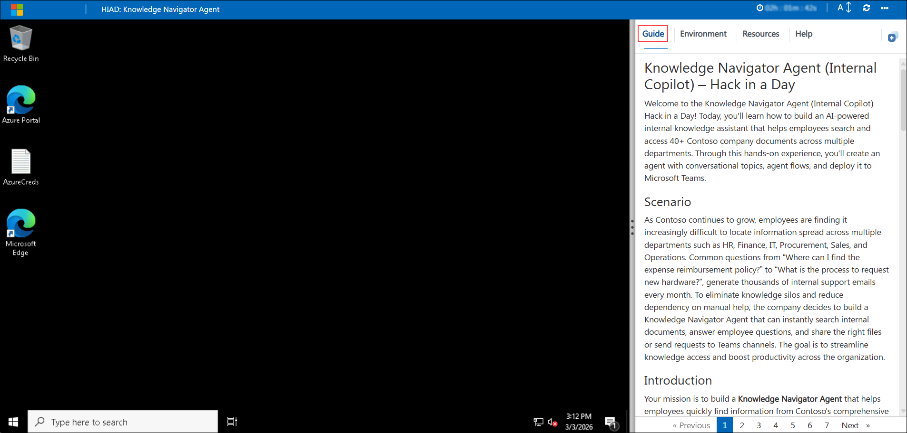

### Exploring Your Challenge Resources

To get a better understanding of your challenge resources and credentials, navigate to the Environment tab.

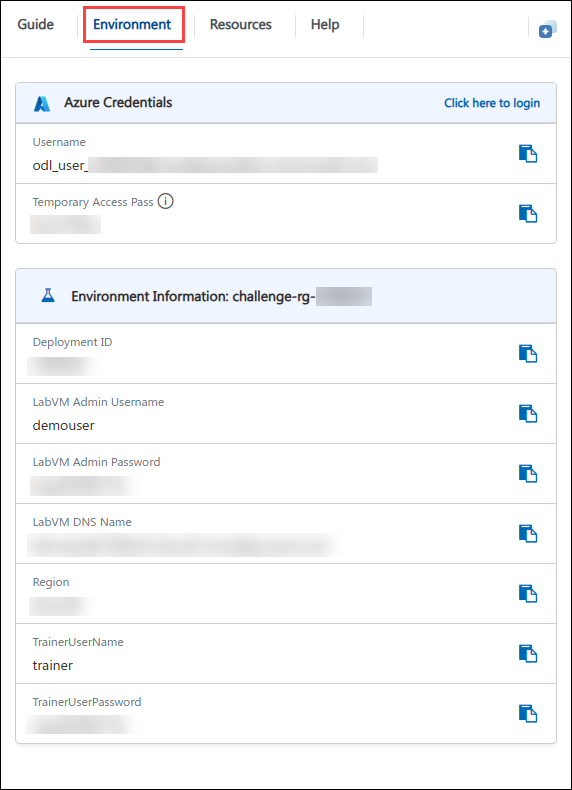

### Utilizing the Split Window Feature

For convenience, you can open the challenge guide in a separate window by selecting the Split Window button from the top right corner.

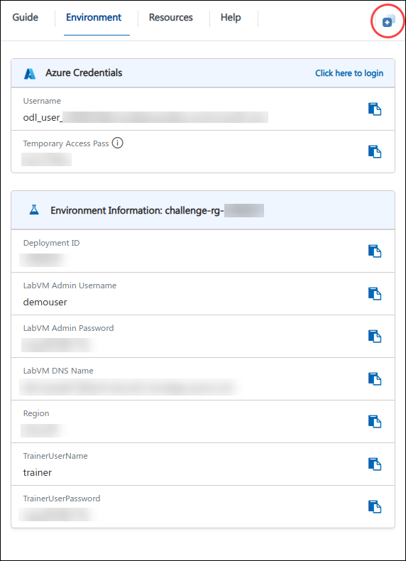

### Managing Your Virtual Machine

Feel free to start, stop, or restart your virtual machine as needed from the Resources tab. Your experience is in your hands!

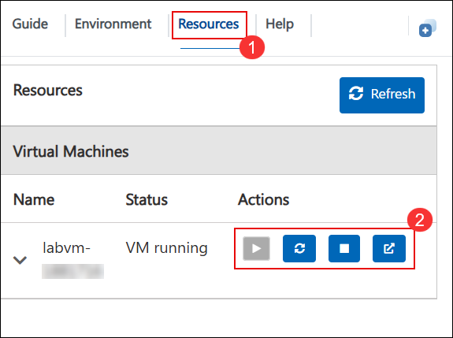

### Let's Get Started with Copilot Studio

1. In the JumpVM, click on the **Microsoft Edge** browser shortcut on the desktop.

   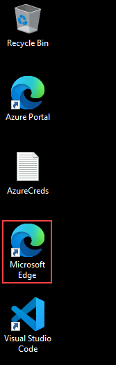

1. Open a new browser tab and navigate to the Power Platform admin center by entering the following URL:

   ```
   https://admin.powerplatform.microsoft.com
   ```

1. On the **Sign into Microsoft** tab, enter the following email **(1)** in the email field, and then click **Next (2)** to proceed.

   - Email: **<inject key="AzureAdUserEmail"></inject>**

     

1. On the **Enter Temporary Access Pass** screen, enter the following **Temporary Access Pass**, and then click **Sign in (2)**.

   - Temporary Access Pass: **<inject key="AzureAdUserPassword"></inject>**

     

1. If you see the pop-up **Stay Signed in?**, click **No**.

   

1. In the **Power Platform admin center**, select **Manage (1)**, choose **Environments (2)**, and then click **ODL_User <inject key="DeploymentID" enableCopy="false"/>'s Environment (3)**.

   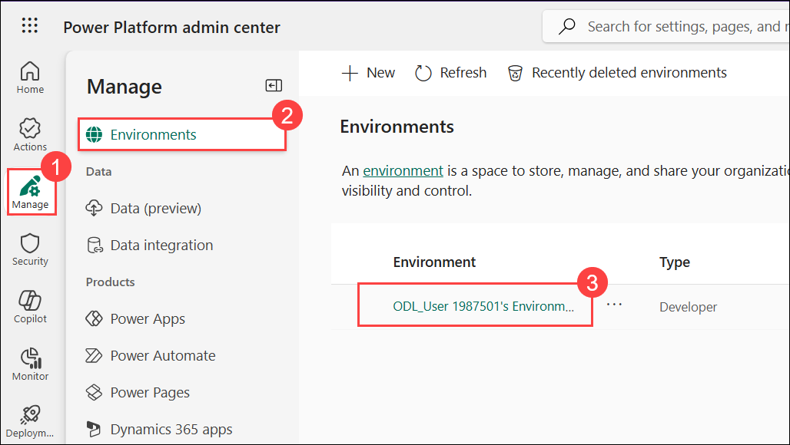

   > **Note:** Please note that you may occasionally see a temporary portal error during this step. This is a known behavior in the Power Platform and does not impact the environment creation process. If it appears, simply close the browser window of Power Platform.

   > Environment provisioning can take up to 15 minutes, especially during periods of high usage. While this is in progress, you can proceed to Challenge 2 and review the datasets already available at **C:\Users\demouser\Downloads** on your LabVM. By the time you're done, your environment should be ready.

1. In the environment page, click on **See all** under **S2S apps**.

   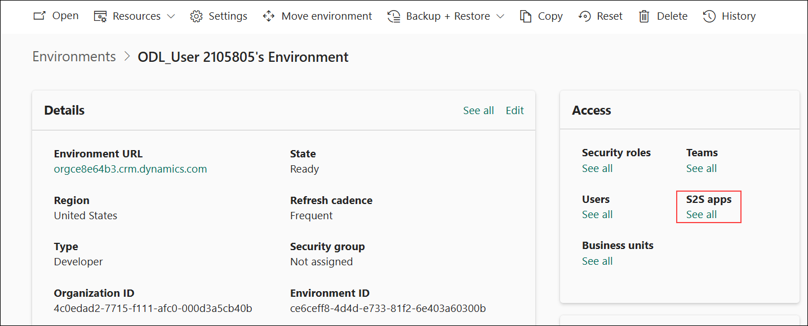

   > <span style="color:red"><strong>Important:</strong> Check whether <code>https://<inject key="domainid" enableCopy="false"/>/cloudlabs.ai</code> is already added. If either one is present, <strong>skip to Step 16</strong>. Otherwise, proceed with the steps below.</span>

   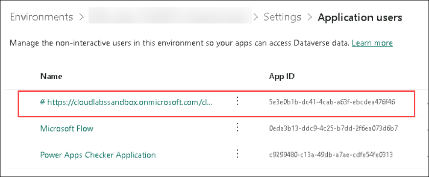

1. In the next pane, click on **+ New app user**.

   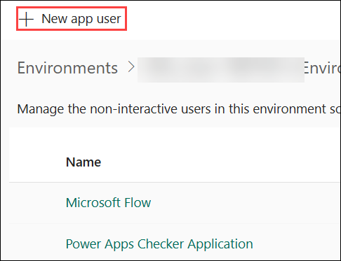

1. In the create a new app user pane, under **App**, click on **+ Add an app**.

   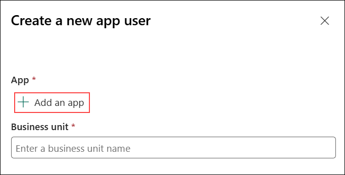

1. In the **Add an app from Microsoft Entra ID** pane, enter **https://<inject key="domainid" enableCopy="false"/>/cloudlabs.ai** in the search box **(1)**, select whichever app is available from the results **(2)**, and then click **Add (3)**.

   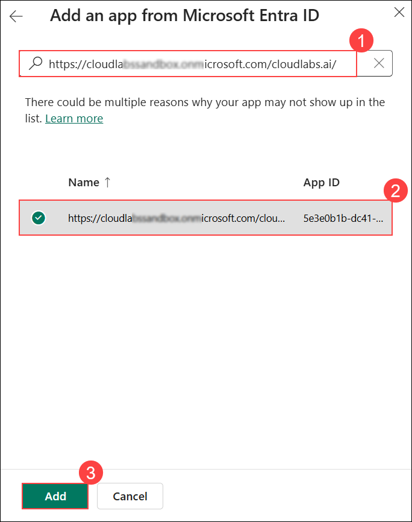

   > <span style="color:red"><strong>Important:</strong> If you cannot find the app in the search results, it is likely that it has already been added. Return to the <strong>Step 8</strong> and verify whether the app is listed. If it is present, skip to <strong>Step 16</strong>.</span>

1. Under **Business unit**, select the available business unit from the list **(2)**.

   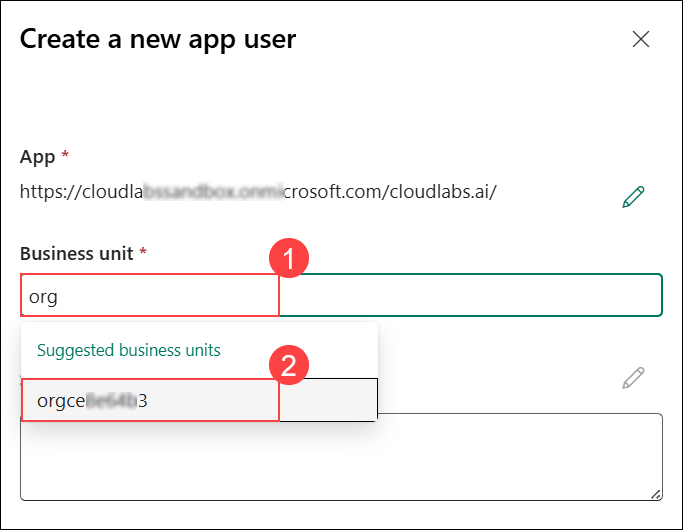

1. Beside **Security roles** click on **Edit** icon.

   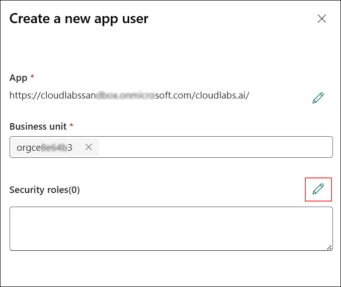

1. In the **Sync Permissions** pane, select **System Administrator (1)**, and then click **Save (2)**.

   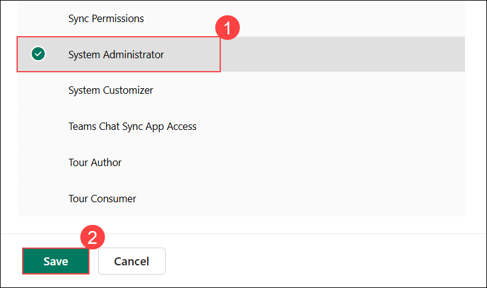

1. In the pop-up window, select **save**.

   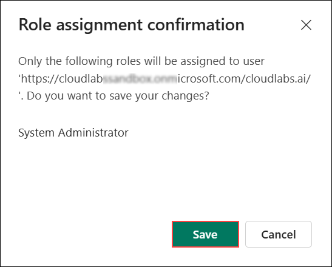

1. Review all the details and click on **Create**.

   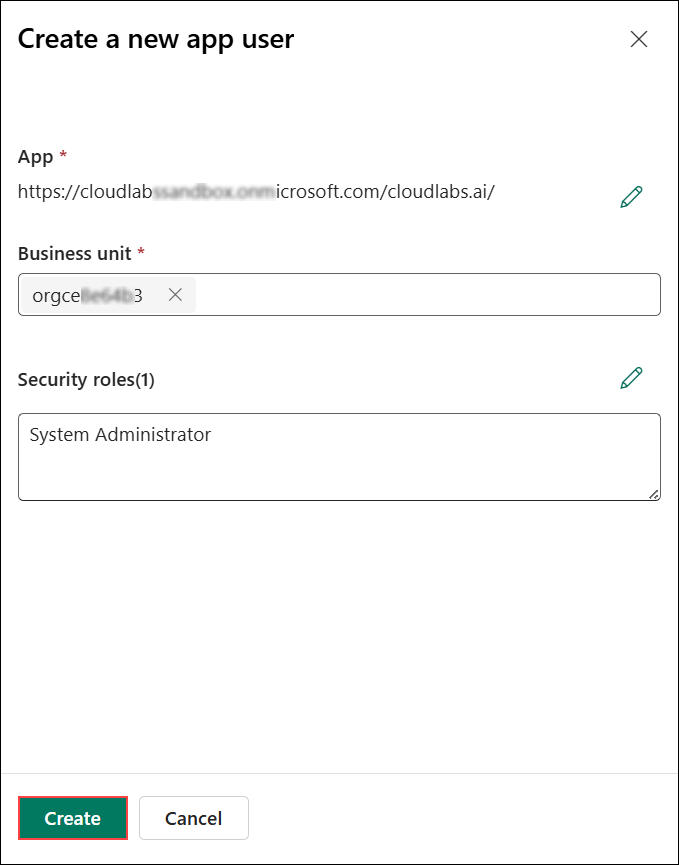

1. Navigate to **Microsoft Copilot Studio** by opening a new browser tab and entering the following URL:

   ```
   https://copilotstudio.microsoft.com
   ```

1. You land on the **Copilot Studio** portal. Confirm the **New experience** toggle in the top-right corner is turned **on**, since this lab is built entirely in the new experience.

   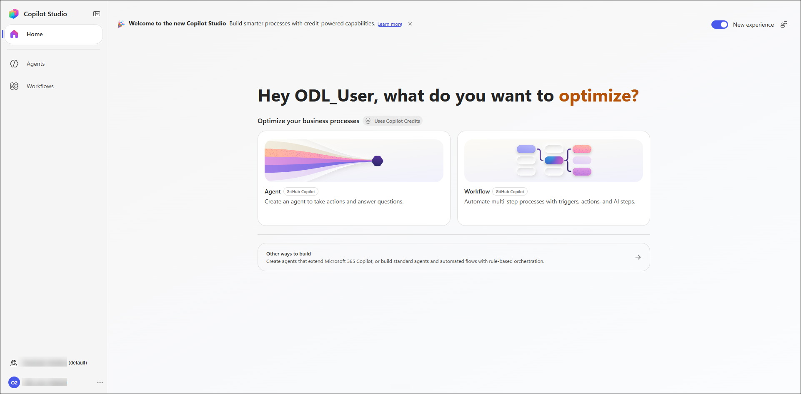

1. In Copilot Studio, open the environment picker **(1)**, expand and select **ODL_User <inject key="DeploymentID" enableCopy="false"></inject>'s Environment (2)** to switch.

   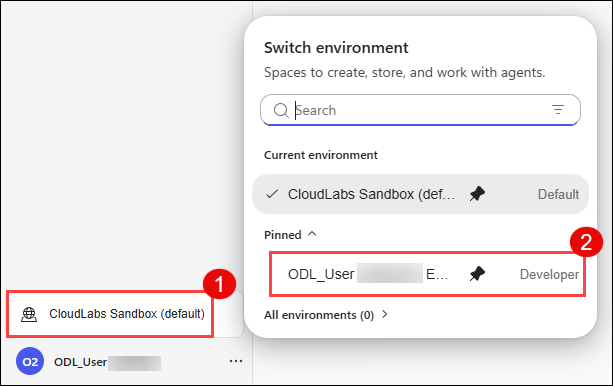

1. You are now ready to start building your **Knowledge Navigator Agent** using Microsoft Copilot Studio.

   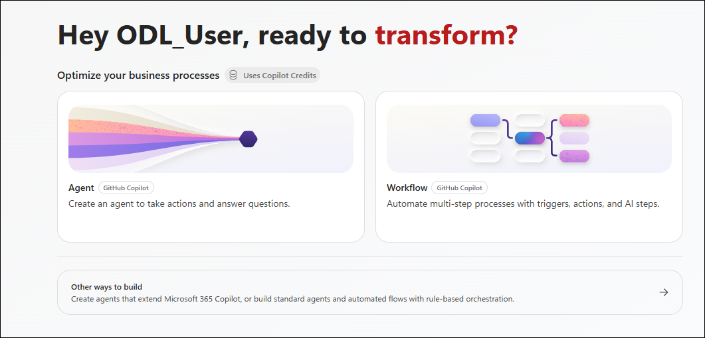

## Challenge 1: Create Internal Knowledge Copilot in Copilot Studio

### Introduction

Employees across organizations waste valuable time searching for internal policies, procedures, and guidelines scattered across different departments. Traditional document repositories and file shares make it difficult to find relevant information quickly, leading to repeated questions to managers and colleagues.

In this challenge, you will create an AI-powered Internal Knowledge Copilot using Microsoft Copilot Studio that will serve as your intelligent assistant to help employees access information from HR, Finance, IT, and Procurement departments.

### Accessing the Datasets

The datasets required for this challenge are already available on your LabVM. No download is needed.

They're waiting in File Explorer at:

```
C:\Users\demouser\Downloads\knowledge-dataset\documents
```

This folder holds the Contoso Corp knowledge documents, a mix of Word, Excel, PowerPoint, CSV, and image files covering HR, Finance, IT, and Procurement. You will upload these to the SharePoint **Documents** library later in this challenge.

> **Note:** If the `documents` folder is missing, notify your instructor before continuing.

### Challenge Objectives

- Sign in to Microsoft Copilot Studio
- Create a new agent for internal knowledge navigation
- Configure basic agent settings and identity
- Prepare for knowledge base upload in the next challenge

### Steps to Complete

#### Step 1: Create SharePoint Site

1. Sign in to Microsoft 365 and stand up the SharePoint site that will hold the Contoso knowledge base:

   ```
   https://myapps.microsoft.com
   ```

   - **Email/Username:** <inject key="AzureAdUserEmail"></inject>
   - **Password:** <inject key="AzureAdUserPassword"></inject>

1. Dismiss any "Stay signed in?" prompt with **No**.

1. Launch **SharePoint** using its app icon.

   > **Note:** If you don't see the SharePoint icon on the page, go directly to **https://<inject key="tenantname" enableCopy="false"/>.sharepoint.com/**.

1. In the left pane, select **Build**, then select **Site** under **Start building**.

1. On **Select a site template**, keep **Team site** selected, choose **Standard team**, and then select **Use template**.

1. On **Set up your site**, enter these settings and select **Create site**:

   | Setting | Value |
   |---|---|
   | Site name | **contoso-documents-<inject key="DeploymentID" enableCopy="false"></inject>** |
   | Site description | "Internal knowledge base for company policies and procedures" |
   | Group email address / Site address | Leave the auto-filled values |
   | Privacy settings | **Public** (anyone in the organization can access) |

   > **Note:** If a message indicates that the SharePoint site name or site alias already exists, enter a different unique site name and continue with the site creation.

1. Finish creating the site (add members if you want, or skip), then open its **Documents** library and upload every file from the LabVM dataset folder:

   ```
   C:\Users\demouser\Downloads\knowledge-dataset\documents
   ```

   Give the upload a few minutes to finish, since there are 40+ documents.

1. Once uploaded, grab the site's URL from the address bar and keep it handy in Notepad. You'll need it in the next challenge.

   > Example format: **https://<inject key="tenantname" enableCopy="false"/>.sharepoint.com/sites/contoso-documents-<inject key="DeploymentID" enableCopy="false"></inject>**

1. Finally, open Microsoft Copilot Studio and confirm you're in the **ODL_User<inject key="DeploymentID" enableCopy="false"></inject>** environment:

   ```
   https://copilotstudio.microsoft.com
   ```

#### Step 2: Create a New Agent

1. From the **New agent** dropdown, select **Agent** under **Optimize your business processes**.

1. Name the agent:

   ```
   Internal Knowledge Navigator
   ```

1. Once your agent is created, change its AI model to **GPT-5 Chat** from the model dropdown **(1)** on the agent's **Build** tab. Use **GPT-5 Chat (2)** throughout this lab to avoid Copilot Credit issues.

   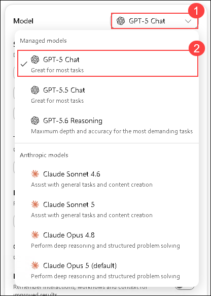

1. Add the following **instructions** to the agent, then save it. You don't need to publish yet, just save.

   > **Tip:** There's no labeled **Save** button here - look for the small save icon in the top toolbar and click that.

   ```
   - Respond only to queries related to Contoso internal company policies, procedures, business operations, and department-specific guidelines.
   - Retrieve knowledge from the uploaded Contoso company documents stored in SharePoint, including HR handbooks, IT governance policies, procurement procedures, support policies, sales playbooks, business reports, and operational data.
   - When answering questions:
     - Provide clear, accurate information based strictly on official Contoso documents
     - Always cite the source document name (e.g., Contoso_HR_Handbook.docx)
     - Use professional, helpful language appropriate for internal employees
     - If information isn't in the knowledge base, direct users to the appropriate department contact
   - For common scenarios, guide users through step-by-step processes based on documented procedures
   - Offer to email policy documents or create support tickets when appropriate
   - Maintain employee privacy and confidentiality at all times
   - Focus on providing information from official Contoso documents rather than general knowledge
   ```

#### Step 3: Test Basic Agent Greeting

1. Open the test panel and confirm the agent greets you correctly. Try "Hello" and "What can you help me with?"; the agent should respond with an appropriate greeting.

1. Specific knowledge questions won't work yet; you'll add knowledge sources in the next challenge.

<validation step="f0a7a622-73af-4e80-8f84-13cda3f2e28e" />

> **Congratulations** on completing the Challenge! Now, it's time to validate it. Here are the steps:
> - Hit the Validate button for the corresponding Challenge. If you receive a success message, you can proceed to the next Challenge.
> - If not, carefully read the error message and retry the step, following the instructions in the lab guide.
> - If you need any assistance, please contact us at cloudlabs-support@spektrasystems.com. We are available 24/7 to help.

### Success Criteria

- Created a new agent named **Internal Knowledge Navigator**
- Configured agent

### Additional Resources

- [Microsoft Copilot Studio Overview](https://learn.microsoft.com/microsoft-copilot-studio/fundamentals-what-is-copilot-studio)
- [Create your first copilot](https://learn.microsoft.com/microsoft-copilot-studio/fundamentals-get-started)

## Challenge 2: Connect SharePoint Knowledge Source

### Introduction

Now that you've created your Internal Knowledge Navigator copilot and uploaded all Contoso company documents to SharePoint in Challenge 1, it's time to connect that SharePoint site to your copilot as a knowledge source. This will enable your copilot to search through all 40+ company documents and provide accurate answers to employee questions.

In this challenge, you'll connect the SharePoint site to Copilot Studio, verify the knowledge source is properly indexed, and test basic knowledge retrieval to ensure your agent can answer questions using the Contoso documents.

### Challenge Objectives

- Connect the SharePoint site as a knowledge source in Copilot Studio
- Configure knowledge source settings

### Prerequisites

Before starting this challenge, ensure you have:

- Created the **Internal Knowledge Navigator** agent in Challenge 1
- Created the SharePoint site **contoso-documents-<inject key="DeploymentID" enableCopy="false"></inject>** in Challenge 1
- Uploaded all 40+ Contoso documents to the SharePoint site in Challenge 1
- Saved the SharePoint site URL

### Steps to Complete

#### Step 1: Add SharePoint Knowledge Source

1. Open your **Internal Knowledge Navigator** agent in Microsoft Copilot Studio, making sure you're in the **ODL_User<inject key="DeploymentID" enableCopy="false"></inject>** environment:

   ```
   https://copilotstudio.microsoft.com
   ```

1. Add your Challenge 1 SharePoint site as a knowledge source:

   ```
   https://<inject key="tenantname" enableCopy="false"/>.sharepoint.com/sites/contoso-documents-<inject key="DeploymentID" enableCopy="false"></inject>
   ```

   > **Tip:** Go back to your SharePoint site in another tab and copy it from the address bar and paste it.

1. Wait for the confirmation that the site has been added.

   > **What's happening:** Copilot Studio is now connecting to your SharePoint site and will automatically index all 40+ documents you uploaded in Challenge 1.

1. Save the agent after adding the knowledge source.

#### Step 2: Verify Knowledge Source Connection

1. In the **Knowledge** pane, confirm the site appears as a knowledge source, open and verify the status reaches **Ready**.

   > **Note:** The SharePoint connector will automatically index all documents in the Documents library. You don't need to upload individual files.

1. If the status shows **Failed** or **Error** instead, double-check the SharePoint site URL.

### Success Criteria

- SharePoint knowledge source is connected to Copilot Studio

### Additional Resources

- [Add knowledge sources to your copilot](https://learn.microsoft.com/microsoft-copilot-studio/nlu-boost-conversations)
- [Generative answers with uploaded files](https://learn.microsoft.com/microsoft-copilot-studio/nlu-boost-node)

## Challenge 3: Create Agent Skills and Agent Flow for Email Action

### Introduction

Your Internal Knowledge Navigator copilot can now answer employee questions by searching through the Contoso SharePoint knowledge base. However, a truly useful enterprise copilot should go beyond just providing answers - it should also be able to take actions on behalf of employees. One common workplace scenario is when an employee needs a specific document sent to their inbox or wants to submit a formal access request for restricted content.

In this challenge, you'll extend your copilot's capabilities by creating agent skills and an agent flow that enables document access requests via email. You'll use Copilot Studio's skills to define structured behaviors that guide employees through the request process, and then wire up a Power Automate flow that sends a structured email to the admin team. This flow will be created first so it's ready to integrate with the agent skills in Challenge 4.

### Challenge Objectives

- Create 2 agent skills (New Employee Onboarding and Email Document) in Copilot Studio
- Build an agent flow using Power Automate to send document access request emails via Office 365 Outlook
- Configure flow inputs (employee email, document name, description) and outputs (email status)
- Verify the flow is published and ready for integration with agent skills in the next challenge

### Prerequisites

Before starting this challenge, ensure you have:

- Completed Challenge 1 (created the **Internal Knowledge Navigator** agent)
- Completed Challenge 2 (connected SharePoint knowledge source)
- Access to **Microsoft Copilot Studio** and **Power Automate**

### Steps to Complete

#### Step 1: Open the Skills Section

1. Open your **Internal Knowledge Navigator** agent.

1. In the right-hand panel, locate **Skills** and select the **+**.

1. In the **Add skill** dialog, select **Create from blank**.

#### Step 2: Create Skill 1 - New Employee Onboarding

1. In the **Add skill** dialog (**Create from blank**), fill in:

   - **Name:**

     ```
     new-employee-onboarding
     ```

   - **Description:**

     ```
     Use this skill when a new employee asks about company policies, procedures, organizational structure, benefits, workplace resources, or onboarding requirements.
     ```

   - **Instructions:** replace the placeholder text with:

     ```
     When this skill is activated:

     1. Assist new employees who are learning about the company. Help them understand company policies, procedures, organizational structure, benefits, workplace resources, and onboarding requirements.
     2. Search the SharePoint knowledge base for information from documents such as the HR Handbook, Onboarding Checklist, IT Governance Policy, Employee Travel Reimbursement guidelines, and other relevant company documents.
     3. Always cite the source document name in your answer.
     4. If the information is not in the knowledge base, tell the employee to contact the HR team instead of guessing.
     ```

1. Select **Create**. The skill now appears under **Skills** on the agent page.

#### Step 3: Create Skill 2 - Email Document

1. Select the **+** next to **Skills** again, choose **Create from blank**, and fill in:

   - **Name:**

     ```
     email-document
     ```

   - **Description:**

     ```
     Use this skill when an employee wants to submit a document access request, request access to a document, or have a document emailed to them.
     ```

   - **Instructions:**

     ```
     When this skill is activated:

     1. Recognize requests such as "submit a document request", "request document access", "email me a document", "send me a document", or "I want to request a document".
     2. Collect the following details from the employee, asking one question at a time:
        - The name of the document they need.
        - Their email address.
        - A brief description of why they need the document.
     3. Confirm the collected values back to the employee before continuing.
     4. Tell the employee their request has been submitted and the admin team will review it.
     ```

1. Select **Create**.

1. Save the agent.

> **Note:** In Challenge 4 you'll attach the **Email Document Flow** to this skill so the agent actually sends the request email instead of only acknowledging it.

#### Step 4: Create the Agent Flow

1. On the agent page, select the **+** next to **Tools**.

1. Choose **+ Add** > **workflow**.

1. The flow designer opens with two nodes already in place: **When an agent calls the flow** and **Respond to the agent**.

1. On the **When an agent calls the flow** trigger node, click the **+ add an input**, select **Text** as the type, and name it. Repeat three times for these inputs:

   - `EmployeeEmail`
   - `DocumentName`
   - `DocumentDescription`

<validation step="1036963f-93f7-4fc9-9b6f-77084c6a3c0d" />

> **Congratulations** on completing the Challenge! Now, it's time to validate it. Here are the steps:
> - Hit the Validate button for the corresponding Challenge. If you receive a success message, you can proceed to the next Challenge.
> - If not, carefully read the error message and retry the step, following the instructions in the lab guide.
> - If you need any assistance, please contact us at cloudlabs-support@spektrasystems.com. We are available 24/7 to help.

#### Step 5: Add the Email Action

1. Select the **+** between the two existing nodes and add **Send an email** from **Office 365 Outlook**.

1. If prompted to sign in, use **<inject key="AzureAdUserEmail"></inject>**.

1. Configure the action:

   - **To:** **<inject key="AzureAdUserEmail"></inject>**
   - **Subject:** `Document Access Request - ` followed by the **DocumentName** dynamic content
   - **Body:** the text below, with the dynamic content inserted where marked:

     ```
     Hello Admin,

     An employee has submitted a request for access to the following document.

     Requested Document: [Add DocumentName dynamic content]
     Reason: [Add DocumentDescription dynamic content]
     Requested By: [Add EmployeeEmail dynamic content]

     Please review the request and share the document with the employee.

     Thank you,
     Internal Knowledge Navigator
     ```

     > **Note:** To add dynamic content, leave the cursor at the end, then type **/**.

1. On the **Respond to the agent** node, add one output: **Text** named `EmailStatus` with the value `Email sent successfully`.

#### Step 6: Rename the Flow and Publish

1. Before saving, select the flow name at the top of the designer and rename it to **Email Document Flow**.

   > **Note:** Rename the flow before you save and publish it, not after.

1. Select **Save**, then **Publish**.

1. Return to the agent. The flow now appears under **Tools**, ready to be attached to the **email-document** skill in Challenge 4. Save the agent from the top toolbar.

<validation step="47541ff8-bef9-48b3-9ab6-1b46d31b2fe2" />

> **Congratulations** on completing the Challenge! Now, it's time to validate it. Here are the steps:
> - Hit the Validate button for the corresponding Challenge. If you receive a success message, you can proceed to the next Challenge.
> - If not, carefully read the error message and retry the step, following the instructions in the lab guide.
> - If you need any assistance, please contact us at cloudlabs-support@spektrasystems.com. We are available 24/7 to help.

### Success Criteria

- Successfully created the **new-employee-onboarding** skill
- Successfully created the **email-document** skill
- Created the **Email Document Flow** agent flow with 3 input parameters (EmployeeEmail, DocumentName, DocumentDescription)
- The flow includes a configured **Send an email (V2)** action via Office 365 Outlook
- The flow has an output parameter (EmailStatus) confirming successful email delivery
- The flow is published and ready for use in Copilot Studio

### Additional Resources

- [Create flows for Microsoft Copilot Studio](https://learn.microsoft.com/microsoft-copilot-studio/advanced-flow)
- [Office 365 Outlook connector](https://learn.microsoft.com/connectors/office365/)

## Challenge 4: Connect Topics to Agent Flow and Test End-to-End

### Introduction

In the previous challenge, you created two conversational skills (EmailDocument and NewEmployeeOnboarding) and built a Power Automate agent flow that sends document access request emails.

In this challenge, you'll run end-to-end tests to validate both the knowledge search experience and the email action flow, ensuring your copilot can answer questions *and* take real actions on behalf of employees.

### Challenge Objectives

- Test the knowledge search experience to confirm generative answers work from the SharePoint knowledge base
- Test the EmailDocument topic end-to-end and verify that the document access request email is received in the inbox

### Prerequisites

Before starting this challenge, ensure you have:

- Completed Challenge 3 (created both skills and the **Email Document Flow**)
- The **Email Document Flow** is published and active in Power Automate
- Access to the lab email inbox to verify received emails

### Steps to Complete

#### Test Topics

Open the test panel with the **Preview** button.

#### Test 1. Knowledge Search:

1. Ask `Where can I find information about employee benefits?` and confirm the agent returns relevant, generative answers sourced from the SharePoint knowledge base.

1. Try a second query, `What are the expense reimbursement policies?`, and confirm it's answered the same way, without calling any flows.

   > **Note:** The agent answers knowledge search queries automatically using the SharePoint knowledge source connected in Challenge 2.

#### Test 2. EmailDocument:

1. Start a **New test session** and type `Raise a email document request`. Walk through the conversation, providing a document name (e.g., "HR Handbook"), your Lab email address, and a brief reason (e.g., "Need to review HR policies"), and confirm the agent reports the request as submitted.

1. Check the inbox at **<inject key="AzureAdUserEmail"></inject>** for the document access request email carrying the document name, reason, and requester's email.

### Success Criteria

- Knowledge search test queries return accurate generative answers sourced from the SharePoint knowledge base
- The EmailDocument tool test triggers the flow and sends the document access request email
- The email is received in the lab inbox with the correct document name, reason, and requester details

### Additional Resources

- [Create topics with Copilot](https://learn.microsoft.com/microsoft-copilot-studio/nlu-authoring)
- [Call flows from topics](https://learn.microsoft.com/microsoft-copilot-studio/advanced-flow)
- [Work with variables](https://learn.microsoft.com/microsoft-copilot-studio/authoring-variables)

## Challenge 5: Publish Your Agent to Microsoft Teams

### Introduction

The final step is to deploy your Internal Knowledge Navigator agent to Microsoft Teams, making it accessible to employees in your organization. Teams is the perfect channel for knowledge sharing, as employees can get help directly where they already collaborate and communicate.

In this challenge, you will publish your agent, add it to Teams, and test the complete user experience.

### Challenge Objectives

- Publish the agent to Microsoft Teams
- Test topics and flows in Teams

### Steps to Complete

#### Step 1: Publish the Agent to Microsoft Teams

1. In **Copilot Studio**, open your **Internal Knowledge Navigator** agent's **Publish dropdown** page and select the **Teams and Microsoft 365 Copilot**.

1. **Save and Publish** the agent from **Teams + Microsoft 365** preview.

1. From the **Preview**, open the agent in Microsoft Teams (continue in the **Teams web app** if prompted), install the **Internal Knowledge Navigator** app, and open it.

   > **Note:** If the install option does not appear, go back to the previous step and add the channel again.

#### Step 2: Test Your Agent in Teams

Test the topics you built in Challenge 4 and the agent's knowledge search, this time from inside Teams:

##### Test Knowledge Search:

1. In the agent chat, ask:

   ```
   Where can I find information about employee benefits?
   ```

1. Confirm the agent searches the SharePoint knowledge base and returns relevant, generative answers.

##### Test EmailDocument Topic:

1. Start a **New test session** or **continue the same session** and send:

   ```
   Raise a email document request
   ```

1. Provide a document name, your email address, and a brief reason when asked, and confirm the agent reports the request as submitted.

1. Check the inbox at **<inject key="AzureAdUserEmail"></inject>** for the document access request email carrying the document name, reason, and requester's email.

<validation step="d885b7bf-4f05-447b-b64b-8a412515d94d" />

> **Congratulations** on completing the Challenge! Now, it's time to validate it. Here are the steps:
> - Hit the Validate button for the corresponding Challenge. If you receive a success message, you can proceed to the next Challenge.
> - If not, carefully read the error message and retry the step, following the instructions in the lab guide.
> - If you need any assistance, please contact us at cloudlabs-support@spektrasystems.com. We are available 24/7 to help.

### Success Criteria

- Publish the agent to Microsoft Teams
- Test topics and flows in Teams

### Additional Resources

- [Publish your agent](https://learn.microsoft.com/microsoft-copilot-studio/publication-fundamentals-publish-channels)
- [Deploy to Microsoft Teams](https://learn.microsoft.com/microsoft-copilot-studio/publication-add-bot-to-microsoft-teams)
- [Analyze agent performance](https://learn.microsoft.com/microsoft-copilot-studio/analytics-overview)
- [Share your agent](https://learn.microsoft.com/microsoft-copilot-studio/admin-share-bots)

## Congratulations!

You have successfully built an **AI-powered Internal Knowledge Navigator Agent** using Microsoft Copilot Studio!

### Real-World Applications

This solution can improve knowledge management across:

- **HR & Employee Services:** Onboarding, policies, benefits inquiries
- **IT Support:** Self-service help desk, documentation access
- **Compliance & Training:** Policy distribution, procedure guidance
- **Sales Enablement:** Playbooks, product information, pricing guidelines
- **Operations:** Process documentation, vendor management, procurement workflows

Congratulations on completing this challenge!

## Support Contact

The CloudLabs support team is available 24/7, 365 days a year, via email and live chat to ensure seamless assistance at any time. We offer dedicated support channels tailored specifically for both learners and instructors, ensuring that all your needs are promptly and efficiently addressed.

Learner Support Contacts:

- Email Support: cloudlabs-support@spektrasystems.com
- Live Chat Support: https://cloudlabs.ai/labs-support

## Happy Hacking!!


